# uber256-lab

**Seven 256-byte-class DOS demos: two strange attractors and a Chladni plate on the x87 FPU, a framebuffer-feedback fire, an integer-only Julia set, a picture animated only by the CRT controller, and a texture made of the program's own machine code.**

[](https://github.com/djayuffe/uber256-lab/actions/workflows/ci.yml)

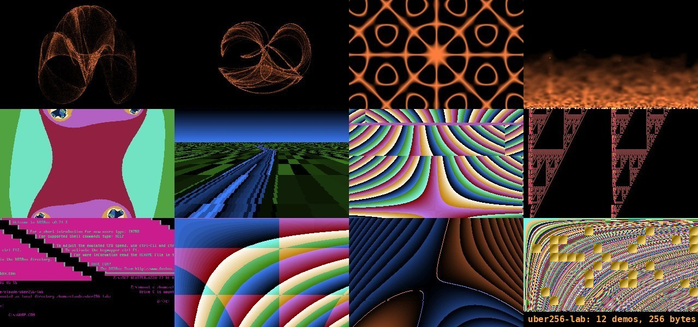

*Real DOSBox 0.74-3 captures of the shipped binaries. Top row: GALAXY at the start and about a minute in, then FIRE.
Bottom row: CLIFF, SELFTEX, JULIA, ESCHER and CHLADNI.*

Everything here is a flat 16-bit real-mode `.COM` file written in NASM. There are no images, no data files, no
libraries, and no DOS calls except setting the video mode and leaving. Every pixel, every palette colour and every
sound is computed by a few hundred bytes of code.

| Program | Size | Needs | What it is |
|---|---|---|---|
| [`GALAXY.COM`](src/galaxy.asm) | 205 B | 386 + FPU, VGA | A de Jong strange attractor drawn as a glowing, fading, slowly morphing cloud. The orbit also tunes the PC speaker. |
| [`CLIFF.COM`](src/cliff.asm) | 210 B | 386 + FPU, VGA | The same engine with Clifford-attractor equations and parameters: two curling wings over a web of caustics. |
| [`FIRE.COM`](src/fire.asm) | 123 B | 386, VGA | Framebuffer feedback: each pixel becomes the average of four pixels below it, minus a little, with random heat injected at the bottom. A smoky turbulent fire, no FPU. |
| [`ESCHER.COM`](src/escher.asm) | 137 B | 386, VGA | The picture is drawn once; after that only the CRT controller's start address and line-compare registers move, folding a hyperbolic texture into an impossible patchwork. No pixel is ever redrawn. |
| [`CHLADNI.COM`](src/chladni.asm) | 224 B | 386 + FPU, VGA | The nodal lines of a vibrating plate, `sin(ax)sin(by) - sin(bx)sin(ay) = 0`, with drifting mode numbers that also tune the speaker. |
| [`JULIA.COM`](src/julia.asm) | 161 B | 386, VGA | A Julia set in 8.8 fixed point. Its constant circles on a Minsky oscillator, so the fractal continually changes shape. No FPU, no sine table. |
| [`SELFTEX.COM`](src/selftex.asm) | 77 B | 386, VGA | Each pixel is a byte of the program's own machine code, picked by `x*y/64 + time`. The hyperbolic bands you see are the code. |

## Contents

- [Run it](#run-it)
- [Screenshots](#screenshots)
- [In motion](#in-motion)
- [GALAXY and CLIFF in detail](#galaxy-and-cliff-in-detail)
- [FIRE in detail](#fire-in-detail)
- [ESCHER in detail](#escher-in-detail)
- [CHLADNI in detail](#chladni-in-detail)
- [JULIA in detail](#julia-in-detail)
- [SELFTEX in detail](#selftex-in-detail)
- [Ideas from the 256-byte brief: what was tried](#ideas-from-the-256-byte-brief-what-was-tried)
- [Testing](#testing)
- [Releases and CI](#releases-and-ci)
- [Limitations](#limitations)
- [Layout](#layout)

## Run it

Download the `.COM` files from the [latest release](../../releases/latest) and run one in
[DOSBox](https://www.dosbox.com/):

```
mount c .
c:
GALAXY.COM
```

Or build from source (needs [NASM](https://www.nasm.us/); on macOS `brew install nasm` and `brew install --cask dosbox`):

```sh
./build.sh              # assembles src/*.asm, enforces the 256-byte limit, writes SHA256SUMS
./run-dosbox.sh galaxy  # galaxy | cliff | selftex
```

**Esc** quits each demo cleanly: it restores text mode 3 and returns to DOS. `DOSBOX.CONF` sets `cycles=max`.
The attractors compute 6000 points per frame with trigonometry, so they want a fast CPU; at a low fixed cycle count
they just run at a lower frame rate.

## Screenshots

All captured from the real binaries in DOSBox.

| | |
|---|---|
| 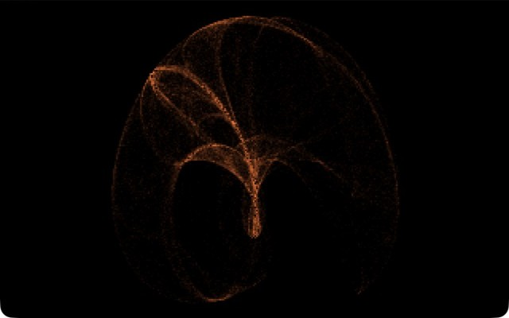 | 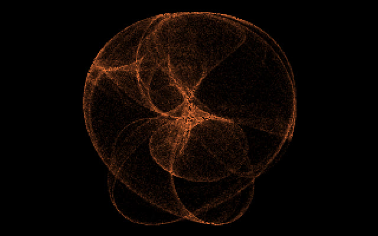 |
| **GALAXY, start.** The de Jong orbit is a spray of arcs fanning out of a bright point. Brightness is the number of times the orbit has landed on a pixel. | **GALAXY, about a minute later.** Two of the four parameters drift every frame, so the same engine turns into a different object: the arcs close into spheres around a dense core. |
| 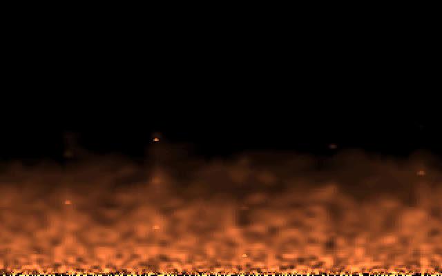 | 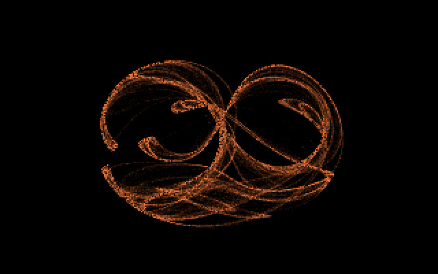 |
| **FIRE.** Heat rises, diffuses and cools. The bright speckle at the very bottom is the injected noise; the swirling plumes above come only from the feedback. | **CLIFF.** A Clifford attractor: two wings, with bright caustic edges where the orbit piles up. |
| 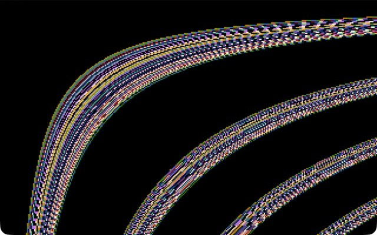 | 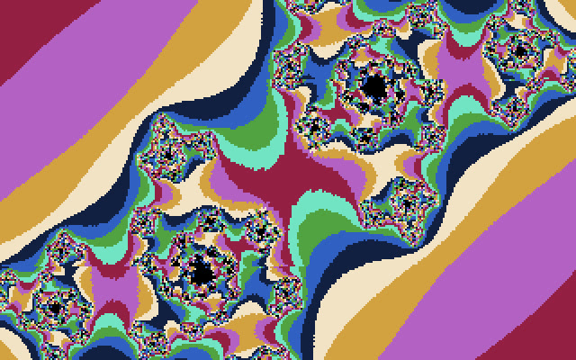 |
| **SELFTEX.** The program's own bytes as a texture. The curves are where `x*y/64 + time` keeps landing on similar code bytes. | **JULIA, one moment.** The black region is the set; the colour bands are how many iterations a point survives before escaping. |
| 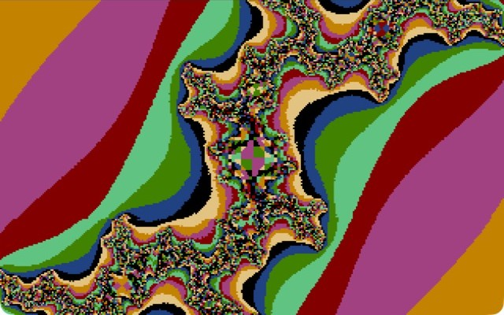 | 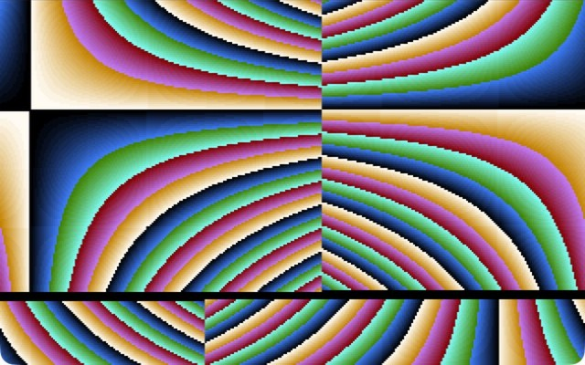 |
| **JULIA, later.** As c moves, the set pinches, twists and breaks into dust, and tiny copies of the whole appear along the spirals. | **ESCHER.** One hyperbolic texture, shown through a moving start address and a line-compare split: the bands meet themselves at seams that cannot be real. |
| 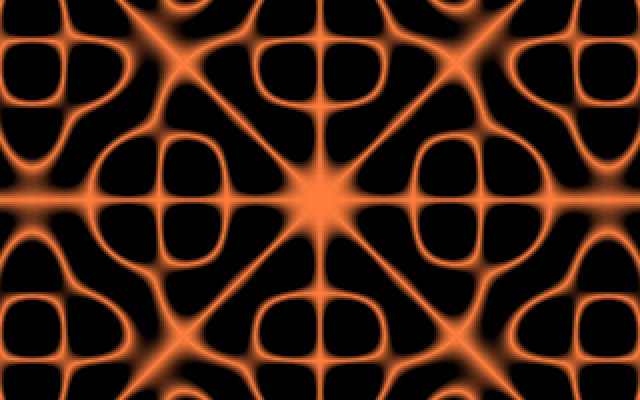 | 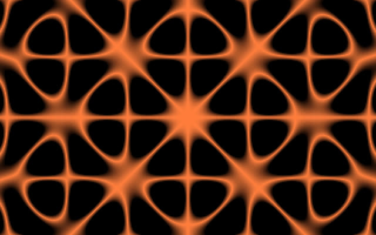 |
| **CHLADNI.** Sand gathers on the lines where the plate does not move. | **CHLADNI, later.** As the mode number drifts, the nodal lines reconnect into loops, then a lattice. |

## In motion

Real recordings of the shipped binaries in DOSBox 0.74-3 (`cycles=max`), so what you see is the real frame rate of each demo, not an emulator's idea of it.

| | |
|---|---|
| 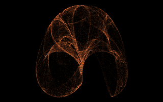 | 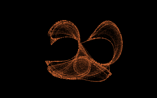 |
| **GALAXY**, 16 s: the orbit cloud builds up and slowly changes shape as two parameters drift. | **CLIFF**, 14 s: the same engine with Clifford equations. |
| 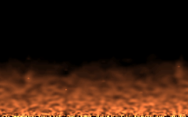 | 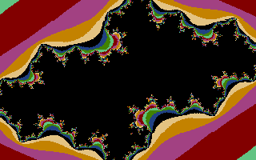 |
| **FIRE**, 10 s: the flames rise from the first frame, from the hot row at the bottom. | **JULIA**, 24 s: each frame is drawn top to bottom, and the set changes as c moves. |
| 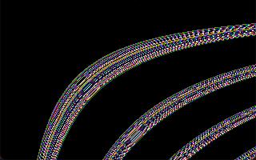 | 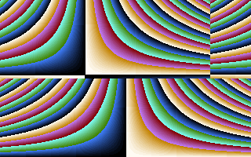 |
| **SELFTEX**, 8 s: the bands slide as the frame counter is added to the lookup index. | **ESCHER**, 9 s at 20 fps: the blocks slide and the seams move; only CRTC registers change. |
| 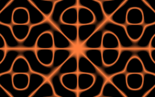 | |
| **CHLADNI**, 10 s: nearly every video frame is a new picture (about 27 fps in DOSBox) as the mode number drifts. | |

*How they were made: with DOSBox in front, its window was screen-captured at 30 to 60 frames per second (cropped to the window only), then converted to 25 fps GIFs at the native 320x200 (ESCHER at 20 fps to keep it small) with a reduced palette. A small patch where the mouse pointer sat at the top edge was painted black. GIF cannot show a 70 Hz display, so very fast detail is smoother in the real thing.*

## GALAXY and CLIFF in detail

The two programs share almost all of their code and differ in the equations and constants. They are an
*accumulating-orbit renderer*: iterate a 2D map thousands of times, add a little light to the pixel under each
point, and fade the whole screen slightly every frame.

### The map

GALAXY iterates the de Jong map

```
x' = sin(a*y) - cos(b*x)
y' = sin(c*x) - cos(d*y)          a = 1.4, b = -2.3, c = 2.4, d = -2.1
```

and CLIFF the Clifford map

```
x' = sin(a*y) + c*cos(a*x)
y' = sin(b*x) + d*cos(b*y)        a = -1.4, b = 1.6, c = 1.0, d = 0.7
```

Both keep (x, y) as the top two entries of the FPU stack. One iteration is about twenty x87 instructions
(`fld`, `fmul`, `fsin`, `fcos`, `fsubp` or `faddp`, `fxch`, `fstp`). The four parameters are read straight from memory
with `fmul dword [bx+k]`, so the whole constant block is 28 bytes.

### From orbit to pixel

The point is scaled by 45, rounded with `fistp` into two scratch words, and turned into a screen offset:

```
imul ax,[bx+22],320     ; y * 320
add  ax,[bx+20]         ; + x
add  ax,32160           ; + 100*320 + 160: the centre of the 320x200 screen
xchg ax,di
add  byte [es:di],12    ; add light
```

The scratch words live just past the end of the file, inside the program's own 64 KB segment, so they cost no
bytes. A pixel's brightness is the number of orbit hits it has received (12 per hit), which is what makes dense
regions glow and sparse ones stay faint.

### Palette

The DAC (port 3C9h) is programmed by one small loop that writes red, green and blue from a single counter with a
`shr` between writes: `R = i/4`, `G = i/8`, `B = i/16`. That is a black, red, orange, near-white "fire" ramp with no table.

### Fade and timing

After 6000 points the program waits for the vertical retrace (port 3DAh bit 3), then makes one pass over all
65,536 bytes of the segment: `v = v - (v >> 4) - 1`, clamped at zero by `sub al,1` / `adc al,0`. The `loop`
instruction does the counting; CX is already 0 at that point, so 65,536 passes cover the segment exactly once.
Light therefore decays exponentially, and a moving attractor leaves soft trails.

### Morphing

Each frame, parameters `a` and `d` (offsets 0 and 12) are nudged by a small constant (0.0006 for GALAXY, 0.0004 for
CLIFF) in a two-pass loop (`mov si,12` ... `sub si,12` / `jnc`). The attractor slowly turns into related ones, which is
why screenshots a minute apart look like different objects.

### Sound

The speaker is enabled with `mov al,3` / `out 61h,al`, and PIT channel 2 is reprogrammed every frame with the low byte
of the orbit's current x coordinate (`out 42h,al`, then the high byte 3), so the pitch follows the attractor.
**I have not listened to this**: the tests verify the port writes, not the audio.

### Why 386 + FPU

The code is assembled with `CPU 386` for `imul ax,[mem],imm` and the x87 instructions, and calls `fninit` once at
start-up. DOSBox emulates an FPU; on real hardware a 486DX or later (or a 386 with a 387) is needed.

## FIRE in detail

The classic fire effect, written as a test of the brief's "framebuffer feedback" idea. The screen is the simulation state:

```
pixel(x, y) = ( p(x-1, y+1) + p(x, y+1) + p(x+1, y+1) + p(x, y+2) ) / 4  - 1     (clamped at 0)
```

The pass runs from the top row down, so every pixel reads values from below it that have not been updated yet this frame.
Before each pass the last two rows are refilled from a 16-bit linear congruential generator (`imul bx,bx,25173` / `add bx,13849`;
the high byte is the noise): a pixel is white-hot if that byte is below 110, otherwise cold. Averaging spreads the heat sideways, the
`-1` cools it, and because the sources are random the plumes never repeat.

The palette is one loop, `R = min(63, i/2)`, `G = i/4`, `B = i/8`: black, red, orange, then a yellow-white at the top of the scale.

This is the version of the feedback idea that works. The earlier NEBULA attempt averaged neighbours with nothing to feed
the screen, so every frame lost energy and it faded to black; here the random rows put it back. The PIT counter (port 40h)
was tried first as the noise source and made smooth blobs instead of flames: successive reads are too correlated, hence the LCG.

## ESCHER in detail

A different kind of animation: **the pixels are written once and never touched again.** The program fills the screen with `(x-160)*(y-100) >> 6`
(hyperbolic bands through the usual wrapping-RGB palette), then spends every frame writing three CRT-controller registers:

- **CR0Ch / CR0Dh, the display start address.** It names which video-memory address appears at the top left. In mode 13h one unit is four pixels, so
  `row * 80 + column / 4` scrolls the whole screen with two port writes. A Minsky oscillator (`bx += bp>>5; bp -= bx>>5`) walks the start address round a circle.
- **CR18h, line compare.** When the scan-line counter reaches this value the CRTC resets its memory address to 0 and starts fetching again from
  the top of video memory. The same texture therefore appears twice, once scrolled and once not, with a seam between them. A counter sweeps the seam down the screen.

Where the display wraps off the end of the 64,000-byte texture the bands meet themselves at a vertical or horizontal seam, which is where the impossible,
patchwork look comes from. Nothing in the picture is calculated per frame: three `out` instructions move an entire image. (The one-scan-line black line at the
seam in the screenshot is DOSBox's rendering of the line-compare reset; I have not seen it on hardware.) The emulator test checks that no pixel changes after the texture is drawn.

## CHLADNI in detail

When a metal plate is bowed, sand collects on the lines that do not move. For a square plate those *nodal lines* are the zero set of a standing-wave
combination such as `f(x, y) = sin(a*x)*sin(b*y) - sin(b*x)*sin(a*y)`. The program evaluates that on the FPU for every pixel (four `fsin` per pixel, about 25 x87
instructions) and makes the pixel bright where `|f|` is small:

```
colour = 255 - min(255, 600 * |f|)
```

The mode number `a` drifts each frame through [1.5, 4.5) using `fprem` (so it can never equal `b = 6` and wash the figure out, as it did in my first version when
`a` crossed `b`), and the same value is written to PIT channel 2, so the tone and the figure change together. `f` is antisymmetric under `x -> -x` and under `y -> -y`,
so `|f|` is symmetric both ways; the test confirms the picture is 100% mirror-symmetric. The picture costs a few million FPU operations a frame, so it runs at a few frames per second in DOSBox.
As with the attractors, **I have not listened to the speaker.**

## JULIA in detail

For every pixel, take z = (x, y) and iterate `z' = z*z + c` until |z|^2 exceeds 4 or 31 steps have passed. Pixels that never escape are
black (they are in the Julia set); the others are coloured by how late they escaped, through the palette.

All of it is 16-bit integer maths in **8.8 fixed point** (256 = 1.0), so there is no FPU in the program:

```
imul bx           ; dx:ax = x*x as 16.16
shrd ax,dx,8      ; back to 8.8
...
imul si           ; x*y
shrd ax,dx,7      ; 2*x*y: the shift by 7 does the doubling for free
add  ax,[ci]      ; y' = 2xy + ci
```

`x` and `y` come from one `div` by 320 over the pixel index, centred and doubled (so the screen spans about +-1.25 by +-0.78).

**The constant c moves.** After each frame the program rotates (cr, ci) a little with a *Minsky oscillator*: `cr += ci >> 5`, then
`ci -= cr >> 5` using the updated `cr`. That integer recurrence traces a near-circle of radius 0.7 with no sine table, so c walks around
a circle in the parameter plane and the Julia set transforms continuously: connected shapes, spirals and finally dust.

The palette is the usual `R = i`, `G = 2i`, `B = 4i` stream (the DAC keeps six bits), which wraps through saturated bands as the escape count changes.
A frame costs tens of millions of instructions, so it runs at a few frames per second in DOSBox: this is a slow-motion demo, and the emulator
test renders only a handful of frames.

## SELFTEX in detail

```
pixel(x, y) = the byte at offset  ((x*y >> 6) + t) & 255  from 100h      ; the program's own bytes
```

The 77-byte program gets `x` and `y` from one `div` by 320 in a DI loop that wraps the 64 KB segment, multiplies
them, shifts, adds a frame counter, and uses the result as an index into its **own code**, which sits at
offset 100h. The "texture" is the machine code itself: runs of similar opcodes show up as flat areas and the
rest as a coloured scatter. `x*y` is a hyperbola, so the constant-index contours are the curves in the screenshot,
and adding the frame counter slides the whole pattern.

The palette is streamed to the DAC as `i`, `2i`, `4i` (the DAC keeps the low 6 bits), so each byte value is a distinct,
fairly saturated colour. It is the smallest idea in the repo, and the one that most directly asks what the
program looks like when you view it as an image.

## Ideas from the 256-byte brief: what was tried

The project started from a long brief of 256-byte-intro techniques. The honest outcome:

| Idea | Result |
|---|---|
| Dynamical systems / strange attractors on the FPU | **Works.** GALAXY and CLIFF. |
| Accumulation buffer with fade (framebuffer feedback) | **Works.** Used by both attractors. |
| Parameter morphing | **Works.** Two parameters drift per frame. |
| Palette generated by code (no table) | **Works.** All three demos. |
| Orbit-driven PIT sound | Implemented; **unheard**. |
| Noise from a code-only PRNG | **Works.** FIRE's 16-bit LCG. |
| Dynamical system in pure integer maths | **Works as JULIA**: 8.8 fixed point, no FPU. |
| Oscillator without a sine table | **Works.** JULIA's Minsky circle. |
| Code as texture / lookup table | **Works.** SELFTEX. |
| Neighbour-averaging feedback | **Works as FIRE**, with random heat injected every frame. The first attempt ("nebula"), with no energy source, failed: averaging halves the energy and the screen goes black. |
| Carry-flag cellular automaton | Six variants prototyped; none good enough to ship. |
| Integer-expression search scored by compressibility | Ran; no candidate beat the attractors, so none shipped. |
| Genetic search over tiny programs | See [uber-micro-demos](https://github.com/djayuffe/uber-micro-demos) (EVO1, EVO2). |
| VGA latch / CRTC scroll tricks, a single phase-transition system | Not attempted. |

## Second brief: a catalogue of hardware-driven effects

A later brief proposed about 25 further effects built from hidden machine state (CPU flags, the PSP and IVT, VGA latches, planes, CRTC registers, the DAC, the PIT, exceptions, x87 internals). Where I tried one, the result:

| Candidate | Result |
|---|---|
| Line-Compare Escher / Start-Address Hypercube / Split-Pan | **Works as ESCHER.** CRTC start address plus line compare animate an image that is never redrawn. The "bland texture" warning in the brief was right: with an XOR checker it is only a scroll; a hyperbolic texture makes it. |
| Speaker-Chladni | **Works as CHLADNI**, with a true FPU plate equation rather than the brief's integer surrogate. |
| Opcode Moire (the program as lookup texture) | Already done as SELFTEX. |
| DAC Cellular Contours (a cellular automaton in the palette) | **Tried, not shipped.** A running sum over the 768 DAC bytes each frame is Pascal's triangle mod 64; with a smooth start palette or a saturated one it turns into confetti within seconds, even updating only every 16th frame. The palette does read back and write correctly in DOSBox; the rule is the problem. |
| Carry-Lace (the carry flag as hidden memory) | **Tried, not shipped.** The brief's loop ends in `test di,di`, which clears CF every pixel, so the carry never reaches the next pixel. What remains is a 9-bit exact average of the left and upper neighbours (`adc` + `rcr`) plus a phase: diagonal dune strata for the first few frames, then fine noise. Ending the loop with `loop` instead (flags untouched) makes the carry real, and looks much the same. |
| Return-Address Rain, IVT Constellation, PSP Voronoi, BIOS Font Diffraction, command-tail bloom, instruction-phase decoding, latch morphology, plane effects, logical brush, overscan halo, IRQ and exception effects, beam-raced self-modification, glyph genome and the rest | **Not attempted yet.** Several depend on timing or inherited state that DOSBox cannot confirm; the brief itself rates them least robust. |

## Testing

`tests/run_tests.sh` builds everything and runs each `.COM` in an emulated 16-bit CPU
([Unicorn](https://www.unicorn-engine.org/), x87 included), entered the way DOS enters a program
(`CX = 00FFh`, `SI = 0100h`, `DX = 0192h`, `BP = 091Ch`). INT, IN and OUT are trapped. It runs 78 checks:

- **All demos:** at most 256 bytes; the first call is `INT 10h` with AX = 0013h; all 768 DAC values are written and the
  palette is not black; no memory is touched outside video RAM and the program's own segment.
- **GALAXY and CLIFF:** FPU opcodes are present; a curve (500 to 30,000 lit pixels) is drawn and stays inside the
  screen; many brightness levels appear (accumulation rather than on/off); the picture changes between frames;
  the speaker is on and PIT channel 2 is re-tuned.
- **FIRE:** the bottom is hot and the heat dies off with height; a smooth ramp of values; the flames move; no sound.
- **ESCHER:** the texture is drawn once and no pixel is ever written again; each frame writes the CRTC start-address and line-compare registers; the start address moves inside video memory and the split sweeps one scan line per frame.
- **CHLADNI:** four `fsin` per pixel; bright nodal lines with smooth falloff; the picture is mirror-symmetric as the equation requires; the speaker is retuned; the figure changes as the mode number drifts.
- **JULIA:** colour bands, a black set that fills part of the screen, point symmetry, no FPU or sound in the code, the picture changes as c moves.
- **SELFTEX:** a rich, textured screen (dozens of colours); it scrolls between frames; no sound.
- **All demos:** pressing Esc ends with `INT 10h` AX = 3 and a clean return to DOS.

An emulator cannot judge how a demo looks, so each one was also run in real DOSBox and captured (the screenshots above).
Needs Python 3; the script installs `unicorn` into `./.venv`.

## Releases and CI

Every push and pull request builds the demos, enforces the 256-byte limit and runs the tests on GitHub Actions. To publish a release,
add a section to `CHANGELOG.md` and push a tag:

```sh
git tag v1.5.0 && git push origin v1.5.0
```

The release workflow rebuilds, re-tests, and attaches the `.COM` files, `SHA256SUMS` and the gallery image, with that section as the notes.

## Limitations

- GALAXY and CLIFF need an FPU and are not meant for slow machines. FIRE touches 64,000 pixels four times a frame and wants a fast CPU too.
- The speaker output has never been listened to.
- The attractors were tuned by eye in DOSBox; the glow palette may look slightly different on other VGA hardware.
- Only 320x200 VGA mode 13h is used, and the programs do not check that the machine has VGA. ESCHER writes CRTC registers (start address and line compare only, never the timing registers) and was checked in DOSBox only.
- Not tried on real hardware.

## Layout

```
src/galaxy.asm      de Jong attractor
src/cliff.asm       Clifford attractor
src/fire.asm        framebuffer-feedback fire
src/escher.asm      CRTC-only animation (start address + line compare)
src/chladni.asm     Chladni plate nodal lines on the FPU
src/julia.asm       integer Julia set with an orbiting constant
src/selftex.asm     self-code texture
build.sh            NASM build + 256-byte gate + SHA256SUMS
run-dosbox.sh       DOSBox launcher
DOSBOX.CONF         DOSBox settings (cycles=max)
tests/              emulator tests
docs/               real DOSBox screenshots
CHANGELOG.md        release notes
.github/workflows/  CI and tag-driven releases
```

## Related

[uber-micro-demos](https://github.com/djayuffe/uber-micro-demos) (29 demos under 9 bytes) and
[uber-tiny-demos](https://github.com/djayuffe/uber-tiny-demos) (the index of these projects).

## License

MIT. See [LICENSE](LICENSE).
