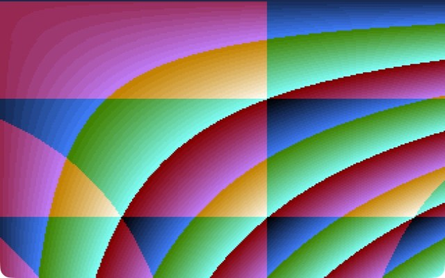
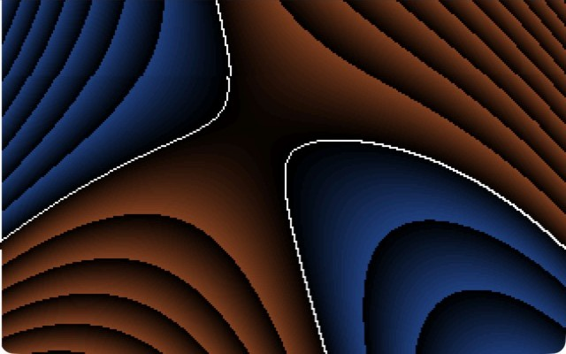
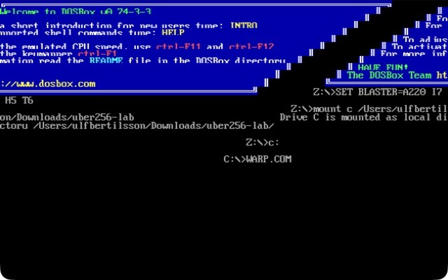
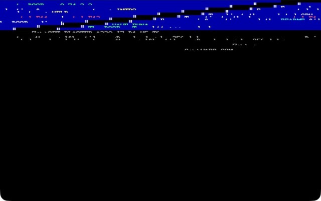
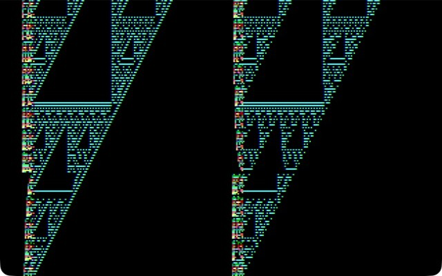
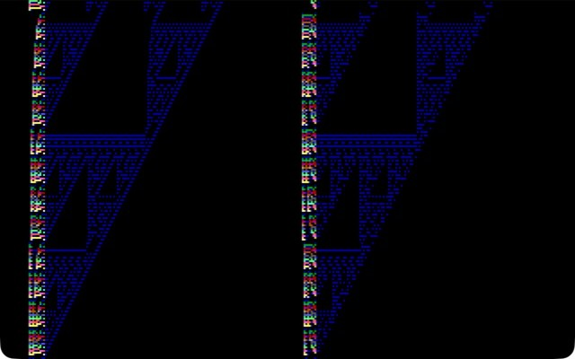
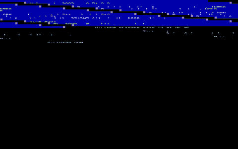
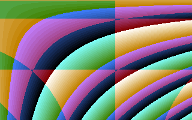
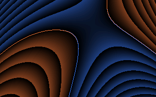
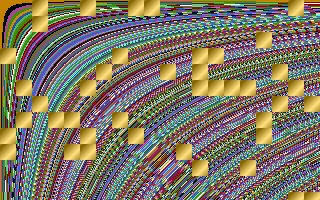

# uber256-lab

**Twelve DOS demos of 256 bytes or less, each playing its own generated music: two strange attractors and a Chladni plate on the x87 FPU, a framebuffer-feedback fire, an integer-only Julia set, a picture animated only by the CRT controller, a cellular automaton computed by the VGA's own logic unit, the DOS screen warped by two CRTC registers, a picture made only of orderings, the migrating roots of a polynomial, a river and a field of golden blocks made of the program's own machine code.**

[](https://github.com/djayuffe/uber256-lab/actions/workflows/ci.yml)


*Real DOSBox 0.74-3 captures of the shipped binaries. Top row: GALAXY, CLIFF, CHLADNI, FIRE. Middle: JULIA, SELFTEX, ESCHER, LATCH. Bottom: WARP, ORDER, ROOTS, GOLDTEX.*

Everything here is a flat 16-bit real-mode `.COM` file written in NASM. There are no images, no data files, no
libraries, and no DOS calls except setting the video mode, hooking the timer tick and leaving. Every pixel, every
palette colour and every note is computed by a few hundred bytes of code. The music goes out as General MIDI through an
MPU-401, which DOSBox provides out of the box (and plays through the system's synthesizer on macOS and Windows).

**Watch and listen:** [`docs/uber256-lab-showreel.mp4`](docs/uber256-lab-showreel.mp4) is 77 seconds of all eleven, recorded
in DOSBox with the MIDI they actually sent, rendered through the FluidR3 General MIDI soundfont.

| Program | Size | Needs | What it is | Music |
|---|---|---|---|---|
| [`GALAXY.COM`](src/galaxy.asm) | 253 B | 386 + FPU, VGA, MPU-401 | A de Jong strange attractor drawn as a glowing, fading cloud whose shape swings slowly back and forth. | The orbit plays itself: its current x position picks a vibraphone note every other tick. |
| [`CLIFF.COM`](src/cliff.asm) | 256 B | 386 + FPU, VGA, MPU-401 | The same engine with Clifford-attractor equations and parameters: two curling wings over a web of caustics. | A marimba roll, one note per tick: the orbit's y position picks the note, its x position how hard it is struck. |
| [`FIRE.COM`](src/fire.asm) | 255 B | 386, VGA, MPU-401 | Framebuffer feedback: each pixel becomes the average of four pixels below it, minus a little, with random heat injected at the bottom and one white-hot ember a frame that rises as a spark. No FPU. | A probe drifts through the flames; when it is in one, a nylon guitar plucks, higher the hotter the pixel. Drums and a walking bass underneath. |
| [`ESCHER.COM`](src/escher.asm) | 243 B | 386, VGA, MPU-401 | The picture is drawn once; after that only the CRT controller's start address and line-compare registers, the pixel panning and the palette move, folding a hyperbolic texture into an impossible patchwork with colour streaming through it. No pixel is ever redrawn. | A Shepard scale: it climbs a semitone at a time for ever and never gets higher. Escher's staircase, heard. |
| [`CHLADNI.COM`](src/chladni.asm) | 249 B | 386 + FPU, VGA, MPU-401 | The nodal lines of a vibrating plate, `sin(ax)sin(by) - sin(bx)sin(ay) = 0`, with a mode number that sweeps with the clock. | A probe crosses the plate; where it meets a nodal line, a tubular bell rings, doubled an octave below. |
| [`ROOTS.COM`](src/roots.asm) | 256 B | 386, VGA, MPU-401 | Polynomial root migration: the bright curves are where a cubic in x and y changes sign; as two coefficients sweep at different speeds, the roots migrate, pinch into crossings and reconnect, in new places each time. Warm and cool contour bands show the sign. | Steel drums play the sweeping coefficient T. |
| [`ORDER.COM`](src/order.asm) | 245 B | 386, VGA, MPU-401 | Three cheap expressions per pixel (hyperbolas, vertical lines, horizontal lines) are never drawn; only which of the six orderings they are in is, so the screen is a set of regions whose boundaries fold and collide as time moves while the shading streams through each region's colours. | A pizzicato arpeggio whose root is the ordering under a probe walking down the screen, over drums and a walking bass. |
| [`WARP.COM`](src/warp.asm) | 248 B | 386, VGA, MPU-401 | No video mode, no drawing: the DOS screen you launched it from is squashed, stretched, sheared and bobbed by four CRT-controller and attribute registers, shimmers sideways, and every colour on it runs through a flowing rainbow (black stays black). | An electric piano plays the character height: the arpeggio rises as the text stretches. Drums and a walking bass underneath. |
| [`LATCH.COM`](src/latch.asm) | 245 B | 386, EGA/VGA, MPU-401 | A rule-60 cellular automaton (Sierpinski waterfalls) computed by the VGA graphics controller: each byte read loads 8 pixels x 4 planes into the latches, each write puts them back one row up with an XOR colour applied by the hardware. Its 15 colours run through a flowing rainbow and the picture shimmers. | A music box plays the ruler sequence (0 1 0 2 0 1 0 3 ...), the Sierpinski triangle's rhythm, over drums and a walking bass. |
| [`JULIA.COM`](src/julia.asm) | 252 B | 386, VGA, MPU-401 | A Julia set in 8.8 fixed point. Its constant circles on a Minsky oscillator, so the fractal continually changes shape, and its escape bands flow 18 times a second. No FPU, no sine table. | Each tick, the escape time of the pixel just drawn is a celesta note; the set itself is silence. A low C pedal every 16 ticks. |
| [`SELFTEX.COM`](src/selftex.asm) | 254 B | 386, VGA, MPU-401 | A river made of the program's own machine code: a perspective floor with a river winding across it into the distance, its water code bytes stretched into streaks that flow towards you, its banks fields of code-byte blocks, under a sky ramp. Every texel is a byte of the program. | The same bytes in order, on a kalimba: the score is the program. |
| [`GOLDTEX.COM`](src/goldtex.asm) | 247 B | 386, VGA, MPU-401 | The classic SELFTEX effect, `code[x*y/64 + t]` (hyperbolic bands of machine code in a flowing palette), with golden blocks: the screen is a 16x16 grid and the program's own bytes decide which blocks are gold; they hop across the grid, and their gold ramp cycles so they glitter. | The program's bytes in order on a glockenspiel, doubled an octave up, over drums and a walking bass. |

## Contents

- [Run it](#run-it)
- [Music](#music)
- [Screenshots](#screenshots)
- [In motion](#in-motion)
- [GALAXY and CLIFF in detail](#galaxy-and-cliff-in-detail)
- [FIRE in detail](#fire-in-detail)
- [ESCHER in detail](#escher-in-detail)
- [CHLADNI in detail](#chladni-in-detail)
- [ROOTS in detail](#roots-in-detail)
- [ORDER in detail](#order-in-detail)
- [WARP in detail](#warp-in-detail)
- [LATCH in detail](#latch-in-detail)
- [JULIA in detail](#julia-in-detail)
- [SELFTEX in detail](#selftex-in-detail)
- [GOLDTEX in detail](#goldtex-in-detail)
- [Version 2.3: golden blocks](#version-23-golden-blocks)
- [Version 2.2: the river](#version-22-the-river)
- [Version 2.1: every byte spent](#version-21-every-byte-spent)
- [Version 2: music, fixes and speed](#version-2-music-fixes-and-speed)
- [Size passes](#size-passes)
- [Ideas from the 256-byte brief: what was tried](#ideas-from-the-256-byte-brief-what-was-tried)
- [Second brief: a catalogue of hardware-driven effects](#second-brief-a-catalogue-of-hardware-driven-effects)
- [Third brief: synthesising 4 to 16 byte kernels](#third-brief-synthesising-4-to-16-byte-kernels)
- [Testing](#testing)
- [Releases and CI](#releases-and-ci)
- [Limitations](#limitations)
- [Layout](#layout)

## Run it

Download the `.COM` files from the [latest release](../../releases/latest) and run one in
[DOSBox](https://www.dosbox.com/):

```
mount c .
c:
GALAXY.COM
```

Or build from source (needs [NASM](https://www.nasm.us/); on macOS `brew install nasm` and `brew install --cask dosbox`):

```sh
./build.sh              # assembles src/*.asm, enforces the 256-byte limit, writes SHA256SUMS
./run-dosbox.sh galaxy  # any of: galaxy cliff chladni fire escher julia latch order roots selftex goldtex warp
```

**Esc** quits each demo cleanly: it restores text mode 3, puts the timer vector back and returns to DOS (JULIA draws
about ten frames a second, so hold Esc for a moment). `DOSBOX.CONF` sets `cycles=max` and spells out DOSBox's default
MIDI set-up (`mpu401=intelligent`, `mididevice=default`), which is all the music needs: on macOS and Windows DOSBox
plays General MIDI through the system's built-in synthesizer. On Linux, point `mididevice` at a running synth such as
FluidSynth or TiMidity. Without a MIDI device the demos run silently.

The attractors compute 6000 points per frame with trigonometry, so they want a fast CPU; at a low fixed cycle count
they just run at a lower frame rate. The music does not slow down with them: it runs on the timer.

## Music

Every demo plays its own score, and every score is computed from what the demo is doing. They share one small engine:

- **The clock.** At start-up the program asks DOS for the INT 1Ch vector (the hook the BIOS calls on each of its 18.2 timer
  ticks a second), keeps it on the stack and installs its own handler; on Esc it puts the old vector back. The tempo is the
  clock's, so a demo that draws three frames a second plays exactly as fast as one that draws seventy.
- **MIDI out.** The handler writes to an MPU-401 at port 330h. One `out dx,ax` with AX = 3FC0h sends C0h (program change) to
  the data port and 3Fh (enter UART mode) to the command port at 331h; in UART mode the MPU ignores any further 3Fh, so the
  handler can send it every time instead of keeping state. Then the instrument number, 90h (note on) and the note.
- **The scale.** Every note is in C major pentatonic, so any sequence the demo produces is consonant. The mapping costs
  four bytes: for an even number 2d in AL, `aam 5` / `aad 6` gives 6*(2d div 5) + (2d mod 5) = 2d + (2d div 5) = floor(12d/5),
  which runs 0 2 4 7 9 12 14 16 ... Adding 50 first starts the scale on middle C (d = 25 gives 60).
- **The groove** ([`src/groove.inc`](src/groove.inc), in FIRE, GOLDTEX, LATCH, ORDER and WARP): every fourth tick a GM drum
  on channel 10 (kick, closed hi-hat, snare, hi-hat), and with each kick a bass note on channel 2 whose pentatonic degree
  is the bar number times 4, mod 5 (`shr al,2` / `aam 5`): A, G, E, D, C, walking down for ever. 52 bytes.
- **Velocity = note.** The note byte is sent twice: higher notes are a little louder, and it costs one byte.
- **No note-offs.** Every instrument chosen decays by itself (vibraphone, marimba, bells, guitar, celesta, music box,
  pizzicato, steel drums, kalimba, electric piano), so nothing is left sounding when a demo quits.
- **The clock in the handler** is the BIOS tick count at 0040:006Ch, read as `[fs:46Ch]` (FS is 0 when DOS starts a program).
  The handler never trusts DS (an IBM BIOS enters INT 1Ch with DS = 0040h): it reads the demo's state through CS, ES or the
  registers the interrupted loop left behind.

What each one plays:

| Demo | Instrument | Notes come from |
|---|---|---|
| GALAXY | vibraphone (11) | the orbit's current x coordinate, every other tick |
| CLIFF | marimba (12) | the orbit's current y coordinate, every tick |
| CHLADNI | tubular bells (14) | a probe crossing the plate one row and three pixels per step: a bell only where it is on a nodal line (the bright half of the palette), pitched by the brightness |
| FIRE | nylon guitar (24) | a probe wandering the bottom 60 rows: a note only when the pixel under it is hot, higher for hotter |
| ESCHER | vibraphone (11) | a Shepard scale: every four ticks, five notes an octave apart step up a semitone, with loudness 127 - 3 x distance from the middle, so the top voice fades out as a new bottom voice fades in |
| JULIA | celesta (8) | the escape time of the pixel the main loop has just drawn (DI); the set itself is a rest |
| LATCH | music box (10) | the ruler sequence of the step number (its trailing zero bits: 0 1 0 2 0 1 0 3 ...), the same self-similarity as the Sierpinski triangle on the screen |
| ORDER | pizzicato strings (45) | a four-note arpeggio whose root is the ordering under a probe walking down a diagonal |
| ROOTS | steel drums (114) | T, the coefficient the main loop patches into its own code each frame |
| SELFTEX | kalimba (108) | the program's own bytes, in order, one per step: a riff that repeats every 28 seconds |
| GOLDTEX | glockenspiel (9) | the same, doubled an octave up, with the groove |
| WARP | electric piano (4) | the same triangle wave that sets the character height (BL, the frame counter) |

The MIDI each demo sent in a 15-second DOSBox run is in [`docs/music/`](docs/music), and the recordings with sound are
`docs/*.mp4`. The note streams are checked by the tests and were captured from real DOSBox; the audio was rendered
automatically (FluidSynth, FluidR3 GM) and has not been auditioned by ear, so treat the instrument choices as a starting point.

## Screenshots

All captured from the real binaries in DOSBox (version 1 stills; version 2 draws the same pictures, see
[In motion](#in-motion) for current recordings).

| | |
|---|---|
|  |  |
| **GALAXY, start.** The de Jong orbit is a spray of arcs fanning out of a bright point. Brightness is the number of times the orbit has landed on a pixel. | **GALAXY, about a minute later.** Two of the four parameters drift every frame, so the same engine turns into a different object: the arcs close into spheres around a dense core. |
|  |  |
| **FIRE.** Heat rises, diffuses and cools. The bright speckle at the very bottom is the injected noise; the swirling plumes above come only from the feedback. | **CLIFF.** A Clifford attractor: two wings, with bright caustic edges where the orbit piles up. |
|  |  |
| **SELFTEX** (version 1). The program's own bytes as a texture. The curves are where `x*y/64 + time` keeps landing on similar code bytes; version 2.2 makes them a river (see below). | **JULIA, one moment.** The black region is the set; the colour bands are how many iterations a point survives before escaping. |
|  |  |
| **JULIA, later.** As c moves, the set pinches, twists and breaks into dust, and tiny copies of the whole appear along the spirals. | **ESCHER.** One hyperbolic texture, shown through a moving start address and a line-compare split: the bands meet themselves at seams that cannot be real. |
|  |  |
| **CHLADNI.** Sand gathers on the lines where the plate does not move. | **CHLADNI, later.** As the mode number drifts, the nodal lines reconnect into loops, then a lattice. |
|  |  |
| **ORDER** in DOSBox: hyperbola fans cut by straight partitions, each region an ordering of three numbers. | **ROOTS** in DOSBox: the roots drawn in the brightest shade of their own side, orange where the cubic is positive and blue where it is negative. |
|  |  |
| **WARP.** The DOSBox start-up screen, stretched and sheared into a staircase: the text in memory is unchanged. | **WARP, squashed.** At 4 scan lines per character the whole screen collapses into the top fifth. |
|  |  |
| **LATCH.** Two Sierpinski waterfalls rise from seeds just below the screen; the colourful left edges are the seeds, which change every frame. | **LATCH, another moment.** The XOR colour is the frame counter, so the whole structure changes colour as it flows. |

## In motion

Recordings of the shipped binaries in DOSBox 0.74-3 (`cycles=max`), so what you see is the real frame rate of each demo.
The GIFs are silent; each has an MP4 with its music next to it.

| | |
|---|---|
|  |  |
| **GALAXY**, 9 s ([with sound](docs/galaxy.mp4)): the orbit cloud builds up and slowly changes shape. | **CLIFF**, 9 s ([with sound](docs/cliff.mp4)): the same engine with Clifford equations. |
|  |  |
| **FIRE**, 9 s ([with sound](docs/fire.mp4)): the flames rise from the hot rows at the bottom. | **JULIA**, 9 s ([with sound](docs/julia.mp4)): each frame is drawn top to bottom and mirrored, and the set changes as c moves. |
|  |  |
| **SELFTEX**, 9 s ([with sound](docs/selftex.mp4)): a river of machine code winding into the distance, flowing towards you. | **ESCHER**, 9 s ([with sound](docs/escher.mp4)): the blocks slide and the seam moves; only CRTC registers change. |
|  |  |
| **CHLADNI**, 9 s ([with sound](docs/chladni.mp4)): the nodal lines reconnect as the mode number sweeps. | **LATCH**, 9 s ([with sound](docs/latch.mp4)): the Sierpinski waterfalls rising, one generation per frame. |
|  |  |
| **WARP**, 9 s ([with sound](docs/warp.mp4)): the DOS screen squashing, stretching and shearing. | **ORDER**, 9 s ([with sound](docs/order.mp4)): the regions folding as the three expressions move. |
|  |  |
| **ROOTS**, 9 s ([with sound](docs/roots.mp4)): the root curves migrating, crossing and reconnecting. | **GOLDTEX**, 6 s at 15 fps ([with sound](docs/goldtex.mp4), 10 s at 320x200): golden blocks hopping over bands of machine code. |

*How they were made: DOSBox ran under a virtual X display with its MIDI output sent to a pipe; the window was captured
losslessly at 35 frames per second while the MIDI bytes were time-stamped as they arrived; the GIFs are 25 fps at the
native 320x200, and the MP4s are 640x400 with the captured MIDI rendered by FluidSynth. GIF cannot show a 70 Hz display,
so very fast detail is smoother in the real thing.*

## GALAXY and CLIFF in detail

The two programs share almost all of their code and differ in the equations and constants. They are an
*accumulating-orbit renderer*: iterate a 2D map thousands of times, add a little light to the pixel under each
point, and fade the whole screen slightly every frame.

### The map

GALAXY iterates the de Jong map

```
x' = sin(a*y) - cos(b*x)
y' = sin(c*x) - cos(d*y)          a = 1.4, b = -2.3, c = 2.4, d = -2.1
```

and CLIFF the Clifford map

```
x' = sin(a*y) + c*cos(a*x)
y' = sin(b*x) + d*cos(b*y)        a = -1.4, b = 1.6, c = 1.0, d = 0.7
```

Both keep (x, y) as the top two entries of the FPU stack. One iteration is about twenty x87 instructions
(`fld`, `fmul`, `fsin`, `fcos`, `fsubp` or `faddp`, `fstp`); it ends with `fstp st3` / `fstp st1`, which drops the old
point and leaves the new one in order in two instructions. The four parameters are read straight from memory with
`fmul dword [bx+k]`. The constant block is 20 bytes: the four parameters and one dword that is two constants at once.
Its low word is the integer 45 (the scale, used with `fimul word`), and the whole dword, 3A1D002Dh, is the float
0.000599 (the morph rate): a float's low 16 bits only nudge the last bits of its mantissa.

### From orbit to pixel

The point is scaled by 45, rounded with `fistp` into two scratch words, and turned into a screen offset:

```
imul ax,[bx+24],320     ; y * 320
add  ax,[bx+22]         ; + x
add  ax,32160           ; + 100*320 + 160: the centre of the 320x200 screen
xchg ax,di
add  byte [es:di],12    ; add light
```

The scratch words live just past the end of the file, inside the program's own 64 KB segment, so they cost no
bytes. A pixel's brightness is the number of orbit hits it has received (12 per hit), which is what makes dense
regions glow and sparse ones stay faint.

### Palette

The DAC (port 3C9h) is programmed by one small loop that writes red, green and blue from a single counter with a
`shr` between writes: `R = i/4`, `G = i/8`, `B = i/16`. That is a black, red, orange, near-white "fire" ramp with no table.

### Fade and timing

After 6000 points the program waits for the vertical retrace (port 3DAh bit 3), then makes one pass over all
65,536 bytes of the segment: `v = v - (v >> 4) - 1`, clamped at zero by `sub al,1` / `adc al,0`. The `loop`
instruction does the counting; CX is already 0 at that point, so 65,536 passes cover the segment exactly once.
Light therefore decays exponentially, and a moving attractor leaves soft trails.

### Morphing

Each frame, parameters `a` and `d` (offsets 0 and 12) move by `s*cos(s*t)`, where t is the BIOS tick count and s the
morph rate (0.000599 for GALAXY, 0.000399 for CLIFF), in a two-pass loop (`mov si,12` ... `sub si,12` / `jnc`). Summed over
frames that is a sine: the parameters swing back and forth over a cycle of about 10 minutes (GALAXY) or 14 (CLIFF), with an
amplitude of the frame rate over 18.2 (about 3.9 at 70 frames a second), so the attractor turns into related ones and
comes back. Version 1 added a constant every frame, so after a few minutes the parameters had drifted far enough to
turn the cloud into noise.

### Sound

Version 1 drove the PC speaker from the orbit and never switched it off on exit. The speaker is no longer used; the
orbit plays General MIDI instead (see [Music](#music)): every other tick (GALAXY, vibraphone) or every tick (CLIFF,
marimba) the low bits of the current pixel position pick a pentatonic note. The tick handler reads the position with
`mov al,[cs:bx+22]`: BX holds the data address throughout the main loop, and the BIOS does not touch BX before calling
the hook.

### Why 386 + FPU

The code is assembled with `CPU 386` for `imul ax,[mem],imm` and the x87 instructions, and calls `fninit` once at
start-up. DOSBox emulates an FPU; on real hardware a 486DX or later (or a 386 with a 387) is needed.

## FIRE in detail

The classic fire effect, written as a test of the brief's "framebuffer feedback" idea. The screen is the simulation state:

```
pixel(x, y) = ( p(x-1, y+1) + p(x, y+1) + p(x+1, y+1) + p(x, y+2) ) / 4  - 1     (clamped at 0)
```

The pass runs from the top row down, so every pixel reads values from below it that have not been updated yet this frame.
Before each pass the last two rows are refilled from a 16-bit linear congruential generator (`imul bx,bx,25173` / `add bx,13849`;
the high byte is the noise): a pixel is white-hot if that byte is below 110, otherwise cold. Averaging spreads the heat sideways, the
`-1` cools it, and because the sources are random the plumes never repeat.

The palette is one loop, `R = min(63, i/2)`, `G = i/4`, `B = i/8`: black, red, orange, then a yellow-white at the top of the scale.

This is the version of the feedback idea that works. The earlier NEBULA attempt averaged neighbours with nothing to feed
the screen, so every frame lost energy and it faded to black; here the random rows put it back. The PIT counter (port 40h)
was tried first as the noise source and made smooth blobs instead of flames: successive reads are too correlated, hence the LCG.

Since version 2, DS is set to video memory as well as ES, so the four neighbour reads need no segment prefix (two bytes
smaller, pixel-identical, and about 30% faster in DOSBox: 52 to 68 frames a second). The music is read off the fire:
every other tick a probe moves four rows and three pixels on (wrapping inside rows 141 to 204), and if the pixel under
it is hotter than 40 a nylon guitar plays heat/8 as a pentatonic degree. The cold top of the fire is silent.

## ESCHER in detail

A different kind of animation: **the pixels are written once and never touched again.** The program fills the screen with `(x-160)*(y-100) >> 6`
(hyperbolic bands through the usual wrapping-RGB palette), then spends every frame writing three CRT-controller registers:

- **CR0Ch / CR0Dh, the display start address.** It names which video-memory address appears at the top left. In mode 13h one unit is four pixels, so
  `row * 80 + column / 4` scrolls the whole screen with two port writes. A Minsky oscillator (`bx += bp>>5; bp -= bx>>5`) walks the start address round a circle.
- **CR18h, line compare.** When the scan-line counter reaches this value the CRTC resets its memory address to 0 and starts fetching again from
  the top of video memory. The same texture therefore appears twice, once scrolled and once not, with a seam between them. A counter sweeps the seam down the screen.

**Two fixes in version 2.** The frame loop waited only for "retrace active", and the loop is so short that it
went round about six times in each retrace (421 iterations a second measured in DOSBox), so the split jumped six scan
lines per frame and the oscillator ran six times too fast. It now waits for the end of one retrace and then the start of
the next: one step per displayed frame. And in mode 13h the line-compare value has bits 8 and 9 set (CR07 bit 4 and
CR09 bit 6: the BIOS sets 3FFh, "never"), so writing only CR18 puts the split somewhere between scan lines 768 and 1023,
below a 400-line screen. DOSBox ignores those bits; a real VGA does not. The program clears both once at start
(CR07 bit 4 is writable even with the CRTC write-protect bit on), so the split now sweeps scan lines 0 to 255 on real
hardware too.

**The music** is a Shepard scale. Every four ticks five vibraphone notes an octave apart (24+p, 36+p ... 72+p) step up a
semitone, and each note's velocity is `127 - 3|n - 54|`, a bell over pitch. When p wraps from 11 to 0 the top voice
(barely audible) disappears and a new, barely audible bottom voice appears, so the scale climbs for ever without getting
higher: Escher's *Ascending and Descending* as sound.

Where the display wraps off the end of the 64,000-byte texture the bands meet themselves at a vertical or horizontal seam, which is where the impossible,
patchwork look comes from. Nothing in the picture is calculated per frame: three `out` instructions move an entire image. (The one-scan-line black line at the
seam in the screenshot is DOSBox's rendering of the line-compare reset; I have not seen it on hardware.) The emulator test checks that no pixel changes after the texture is drawn.

## CHLADNI in detail

When a metal plate is bowed, sand collects on the lines that do not move. For a square plate those *nodal lines* are the zero set of a standing-wave
combination such as `f(x, y) = sin(a*x)*sin(b*y) - sin(b*x)*sin(a*y)`, and the picture is bright where `|f|` is small:

```
colour = 255 - min(255, 600 * |f|)
```

**f is separable**, which version 2 uses: X and Y run over the same lattice (X = (x-160)*0.02, Y = (y-100)*0.02, and the
200 values of Y are a subset of the 320 values of X). So each frame first fills a table of `sin(aX)` and `sin(bX)` for the
320 columns (640 FSINs, the X step accumulated on the FPU stack), and then every pixel is four table loads, two multiplies,
a subtraction and a scale: `|T[x].sa * T[y+60].sb - T[x].sb * T[y+60].sa| * 600`. Version 1 did four FSINs per pixel.
For the same mode number the two are pixel-identical (checked in the emulator), and DOSBox draws 34 frames a second
instead of 19.

The mode number `a` now follows the BIOS clock, `a = 3 + sin(0.0115 t)`, so it sweeps smoothly through [2, 4] and back
every 30 seconds (version 1 drifted it through [1.5, 4.5) and jumped back with `fprem`). `b` is 6, so they never meet
(when they do, f is zero everywhere). `f` is antisymmetric under `x -> -x` and under `y -> -y`, so `|f|` is symmetric both
ways, and the test checks the pixels against the formula itself.

The music: every other tick a probe moves one row and three pixels across the plate; where it lands on a nodal line (a
pixel in the bright half of the palette) a tubular bell rings, pitched by the brightness. The rhythm is the figure.

## ROOTS in detail

From the same list, "polynomial root migration" (#9), which turned out to show the list's "catastrophe" idea (#98) too. For each pixel, with X = x - 160 and Y = y - 100:

```
v = X^3/64  +  X (16 S - 6 T - 6 Y)  +  Y^2 T / 16        (32-bit integers)
```

Version 2 evaluates 16 v, in Horner form, so that no term needs a division and every multiplier fits a signed byte:

```
16 v = X (X^2/4 + 256 S - 96 T - 96 Y) + Y^2 T
```

T and S are two triangle waves from one 9-byte subroutine, S four times slower than T. The two linear coefficients are folded into one per-frame constant, `K = 16 S - 6 T`, so a pixel costs one multiply for them, not two.

The program never draws v itself. Bit 7 of each pixel's colour is v's **sign**, and a pixel is a **root** when its sign differs from the pixel to its left or the one above (the row above is already in video memory, so the screen itself is the memory for the edge test; row 0 and column 0 are skipped). A root takes the brightest entry of its own side's ramp: orange on the positive side, blue on the negative. Everywhere else the other bits shade |v| into dim contour bands, warm or cool. The palette is one short loop: each index's low 6 bits are a brightness, and bit 7 swaps red and blue.

As T sweeps, the curves migrate; at some values two branches meet in a crossing and then reconnect the other way, a saddle where the picture's topology changes. The slower S tilts the whole cubic, so each sweep puts the crossings in a different place.

I prototyped about twenty of the list's mechanisms as NumPy models first (Collatz stopping times, coprimality, quadratic residues, 3-adic valuations, bit run lengths, functional-graph basins, determinants, projective curtains, curvature, energy defects of a Minsky circle, wrap-around conservation failure, forward/backward rotation error, integer vortices, an integer logistic map, inverse branches of x^2 mod 256, hysteresis) and only built the two that looked like something: ORDER and ROOTS. Most of the number-theory fields read as noise at screen resolution; several of the others are familiar shapes (hyperbola contours, ray floors, bifurcation diagrams).

**Version 2** had to fit the music into 9 spare bytes, and found 50: the cubic in the Horner form above (`X^2/4` is
floored before the multiply, which moves a few contour-band edges by one step and no sign), T patched into the
immediate of `imul ebx,esi,T` each frame instead of being read from memory per pixel, `cbw` / `cwde` in the triangle
routine, the palette's green from `xchg ax,cx`, the row-0 test as `cmp si,-100` (an 8-bit immediate), and time from the
BIOS clock instead of a frame counter, so there is no retrace wait at all and the animation runs at the same speed on any
machine. One shortcut is visible to a test but not to an eye: column 0 is recognised by the low byte of X alone
(`cmp cl,60h`), which also matches X = 96, so at x = 256 only the upper neighbour is compared (13 pixels in 32 frames
differ from the full test). The music is T itself, played by steel drums on every tick.

## ORDER in detail

From a later brief's list of 100 mechanisms, "permutation boundary objects" (#52): compute several cheap values per pixel, and draw not the values but their **ordering**.

```
a = (x*y)/64 + t       hyperbolas, drifting one way
b = x - 2t             vertical lines, drifting the other way
c = 3y + t             horizontal lines
```

All three are 8-bit and wrap. Three comparisons (`a<b`, `b<c`, `a<c`) are collected into AH with `cmp` / `rcl ah,1`, so the carry flag carries each answer straight into a 3-bit region number; two of the eight patterns are logically impossible, so exactly six regions can appear (the test sees all six). The region selects a 32-entry band of the palette and `a` shades it. Where two of the expressions are equal, a boundary runs; as `t` moves, the hyperbola fans slide across the line grid and regions fold, collide and swap. No sine, square root, table or FPU. Time lives in BP and every expression is computed in a 16-bit register and compared by its low byte, which brought the program from 123 to 108 bytes with identical pixels (106 after a later pass).

Tried from the same list and not shipped: **EUCLID** (#2, colour = the number of subtractions in Euclid's GCD algorithm on the pixel coordinates) shows the expected bright rays at rational slopes, but the background between them is irregular counts that read as noise rather than the promised "crystal city"; **ORBIT** (#47, plotting a full-period 16-bit linear congruential generator as a trajectory) covers the screen uniformly, as a full-period permutation must, so there is nothing to see but noise.

**Version 2** keeps all three incrementally: the outer loop walks rows, `x*y` grows by `y` per pixel, `b` by one, and
`c` is set once per row, so there is no division or multiply per pixel (pixel-identical, 35 to 56 frames a second in
DOSBox). The music is a pizzicato arpeggio: a probe walks down a diagonal, and the ordering under it (0 to 7) is the root
of a four-note figure (root, +2, +4, +6 degrees), so the harmony moves each time the probe crosses a boundary.

## WARP in detail

WARP never sets a video mode and never writes a pixel. It runs on top of whatever DOS screen you launched it from and changes only how the CRT controller **reads** that text:

- **CR09, maximum scan line** (brief #71): the height of a character cell, normally 16 scan lines. A triangle wave steps it through 4..19 lines, so the 400-line display shows the same 25 rows of text squashed into a strip or stretched past the bottom of the screen. Bit 6 (bit 9 of the line-compare value) is kept.
- **CR13, offset** (brief #72): how many words of video memory each text row advances. Normally 40 (80 characters); a slower triangle wave moves it through 36..43, so each row starts a few characters earlier or later than the row above and the screen shears into a staircase that reverses.

Both writes happen once per frame after the vertical retrace; no timing register is touched. The emulator test checks that only those two registers are written, that the character height steps through all 16 values and the stride stays within 36..43, and that the text in video memory is never modified.

The tick handler reads BL, the frame counter that drives the character height, folds it into the same triangle and
plays it on an electric piano: the arpeggio climbs as the text stretches and falls as it squashes, 18 notes a second.

**Tried alongside it and not shipped:**
- **SHEAR** (the same stride trick in mode 13h): in 256-colour mode one CR13 unit is 8 bytes, so the smallest possible change shifts each row 8 pixels further than the one above. Any stride other than the normal one turned a ring texture into horizontal noise.
- **ZOOM** (CR09 in mode 13h, so each texture row repeats 1 to 16 times, with the start address keeping the centre fixed): it works, but in DOSBox every CR09 change makes the emulator rebuild its output surface and several frames came out black; it would flicker. WARP changes the same register in text mode without that problem in the frames I sampled.
- **LATCH with a rotating read map** (brief #75: GR04 cycles through the four planes, so the rule reads a different plane each frame): the Sierpinski structure dissolves into coloured noise inside the same cone.

## LATCH in detail

The brief's highest-rated idea was to treat the VGA as a graphics ALU rather than a framebuffer. LATCH uses the 16-colour planar mode 0Dh, where one byte address holds 8 pixels in each of 4 bit planes, and programs the graphics controller once:

| Register | Value | Meaning |
|---|---|---|
| GR01 | 0Fh | set/reset enabled on all four planes |
| GR03 | 18h | logical function XOR |
| GR05 | 03h | write mode 3: the bit mask is the CPU data |
| GR00 | frame counter | the set/reset colour, rewritten every frame |

The inner loop is four instructions, `es lodsb / rcr al,1 / stosb / loop`, with SI one row (40 bytes) ahead of DI:

- **`es lodsb`** reads a byte from the row below. On the VGA, any read loads all four planes of that address (32 bits, 8 pixels) into the **latches**, and returns plane 0 in AL.
- **`rcr al,1`** shifts that plane-0 mask one pixel to the right. Because bytes go left to right, the carry hands each byte's rightmost pixel to the next byte's leftmost, so the neighbour is exact across byte boundaries.
- **`stosb`** writes one row up. In write mode 3 the VGA takes every pixel from the latches, except where the mask is set; there it XORs the set/reset colour in. So a pixel changes colour when its left neighbour below had plane 0 set: on plane 0 that is the cellular-automaton rule `new(x) = old(x) XOR old(x-1)`, rule 60, whose space-time diagram is the Sierpinski triangle.

Every frame the program writes two seed bytes into the row just below the screen (the frame counter and its complement) and recomputes all 200 rows bottom-up, so each row is the next generation of the row below and the pattern rises. The CPU never computes a colour: the 4-plane copy and the XOR are done by the graphics controller, 32 pixel-bits per `lodsb`/`stosb` pair.

**The music** is the same fractal in time. The ruler sequence, the number of trailing zero bits of the step number
(`bsf`), runs 0 1 0 2 0 1 0 3 0 1 0 2 0 1 0 4 ...; it is the Towers of Hanoi move order and the row-by-row self-similarity
of the Sierpinski triangle. A music box plays it as pentatonic degrees from middle C, every other tick.

**A DOSBox finding.** My first version used the graphics controller's own data rotate (GR03 = 19h, rotate by 1) instead of `rcr`. In DOSBox 0.74 that drew a single rising column: the rotate appeared to have no effect in write mode 3, so the CPU now does the shift. Real VGA hardware applies the rotate before the mask; I have not been able to check that here.

**Testing limits.** The emulated CPU in the test suite has no VGA latches, so its 7 checks cover the register programming, the inner loop and the clean exit; the picture itself has only been seen in DOSBox. Its GIF is rendered, not recorded: my one attempt to screen-record it caught another window instead of DOSBox and was discarded, so the animation comes from the real binary in the emulated CPU with a model of the four planes, the latches, write mode 3 and XOR (it matches the DOSBox stills).

## JULIA in detail

For every pixel, take z = (x, y) and iterate `z' = z*z + c` until |z|^2 exceeds 4 or 31 steps have passed. Pixels that never escape are
black (they are in the Julia set); the others are coloured by how late they escaped, through the palette.

All of it is 16-bit integer maths in **8.8 fixed point** (256 = 1.0), so there is no FPU in the program:

```
imul bx           ; dx:ax = x*x as 16.16
shrd ax,dx,8      ; back to 8.8
...
imul si           ; x*y
shrd ax,dx,7      ; 2*x*y: the shift by 7 does the doubling for free
add  ax,[ci]      ; y' = 2xy + ci
```

`x` and `y` come from one `div` by 320 over the pixel index, centred and doubled (so the screen spans about +-1.25 by +-0.78).

**The constant c moves.** After each frame the program rotates (cr, ci) a little with a *Minsky oscillator*: `cr += ci >> 5`, then
`ci -= cr >> 5` using the updated `cr`. That integer recurrence traces a near-circle of radius 0.7 with no sine table, so c walks around
a circle in the parameter plane and the Julia set transforms continuously: connected shapes, spirals and finally dust.

**Version 2 computes half the picture.** A Julia set is symmetric under z -> -z. With the grid centred between pixels
(x = 2*px - 319, y = 2*py - 199, half a pixel from version 1's) the point mirror of pixel i is exactly pixel 63999 - i, so
the loop computes the top 32,000 pixels and writes each one twice; it also no longer computes the 1,536 bytes past the
screen. DOSBox draws 10 frames a second instead of 2.8. The music is the drawing itself: on each tick the handler reads
the pixel the main loop has just written (DI is the loop's pointer) and plays its escape time on a celesta; a point of
the set (escape time 0) is a rest, so the black regions are silences.

The palette is the usual `R = i`, `G = 2i`, `B = 4i` stream (the DAC keeps six bits), which wraps through saturated bands as the escape count changes.
A frame costs tens of millions of instructions, so it runs at a few frames per second in DOSBox: this is a slow-motion demo, and the emulator
test renders only a handful of frames.

## SELFTEX in detail

Version 2.2 turns the program-as-texture into a river. Below the horizon (row 60) each row is a floor seen in
perspective, with depth `z = 8192 / (y - 60)`, which is also the world step per pixel: `u` (the coordinate across
the view, times 256) starts at `-160 z` and grows by `z` per pixel, in a 32-bit register. Per row:

```
F      = z/4 + t                   distance along the river; t is the BIOS tick, so the camera drifts forward
centre = triangle(F) / 2 - 32      the river bends left and right as it recedes (cbw / xor al,ah is the triangle)
fields = (F >> 4)                  the banks' texture row
water  = (F >> 4) + t              the water's: t further on, so it flows towards you, much faster than the drift
```

and per pixel, with `r = |u - centre|`:

```
r < 24    water:  64 + (code[(r >> 1) + water] AND 63)      streaks along the flow
r < 30    shore:  136, dark
else      fields: 128 + code[(r >> 4) XOR fields]           blocks, mirrored about the river
```

`code[]` is the program itself (`xlat` with BX = 100h), so every texel on the ground is one of its bytes; the sky is
colour y. The palette is one loop: entries 0..127 are a blue ramp (s/4, s/2, s) for the sky and the water, 128..255 a
green one (s/4, s/2, s/8) for the fields, s = i AND 63. The perspective needs two divisions per row and none per pixel.
Time is the BIOS clock, so there is no retrace wait and the river flows at the same speed on any machine.

The music is the code too: every other tick the handler reads the program byte at the step number with `cs xlat`
(BX is still 100h from the main loop) and plays it as a pentatonic degree on a kalimba. Version 2.2 drops the drums
and the second texture layer of 2.1 to make room: the river is 254 bytes.

Earlier versions (73 to 223 bytes) drew `code[(x*y >> 6) + t]`, hyperbolic bands of machine code.

## GOLDTEX in detail

```
pixel(x, y) = code[(x*y >> 6) + t] AND 127                      the classic SELFTEX bands
            = 192 + (code[(x*y >> 6) + t] AND 63)               if code[x/16 + 16(y/16) + t/16] is a multiple of 16
```

The first line is SELFTEX as it was: `xlat` with BX = 100h reads the program's own byte at `x*y/64 + t`, and the
palette flows (entry k = k + t, streamed as i, 2i, 4i). x and y are loop counters (no division per pixel), and the
row's share of the block key, `16 (y/16) + t/16`, is computed once per row into CH. The second line is
the gold. The screen is cut into 16x16 blocks, and block (bx, by) asks the program itself whether it is gold: the code
byte at `bx + 16 by + t/16` (16 by is just `y AND -16`, so the key costs one AND and two ADDs). About one block in six
says yes, and as t moves the key slides, so the golden blocks hop to new places every 16 frames. A gold pixel keeps
its code texel but moves it into colours 192..255, a gold ramp (R = s, G = 3s/4, B = s/4, s in the bright half) that
cycles twice as fast as the rest, so each block glitters with the texture of the code under it.

The palette is rewritten every frame without touching port 3C8h: 768 values bring the DAC's write index back to 0.
The music is SELFTEX's riff (the program's bytes in order) on a glockenspiel, doubled an octave up, over the groove.

## Version 2.3: golden blocks

GOLDTEX (247 bytes) brings back the classic SELFTEX picture, `code[x*y/64 + t]`, and lays a grid of golden blocks
over it (see [GOLDTEX in detail](#goldtex-in-detail)).

## Version 2.2: the river

SELFTEX becomes a river in perspective made of its own machine code (254 bytes; see [SELFTEX in detail](#selftex-in-detail)).

## Version 2.1: every byte spent

Version 2.1 fills the space version 2 left (FIRE had 65 free bytes, LATCH 116, SELFTEX 126, WARP 131) with motion,
colour and a rhythm section. Sizes now: CLIFF 256, ROOTS 256, FIRE 255, GALAXY 253, JULIA 252, CHLADNI 249,
WARP 248, LATCH 245, ORDER 245, ESCHER 243, SELFTEX 223.

| Demo | Eye candy | Music |
|---|---|---|
| WARP | CR08 (preset row scan) bobs the whole screen 0..15 scan lines; the attribute controller's pixel panning shimmers it sideways; the 63 DAC colours above black run through a rainbow, each component a triangle of (time + 86 x byte position), so R, G and B sit a third of a cycle apart | drums + walking bass |
| LATCH | the same rainbow over its 15 colours, and the same panning shimmer | drums + walking bass |
| SELFTEX | a second layer of code bytes on diagonals, `(y-x)/8 - 2t`, added to the first; the whole palette flows; panning shivers the picture | the kalimba doubled an octave up; drums + walking bass |
| ORDER | the shading flows inside each region's band: entry k = (k AND E0h) + ((k + 2t) AND 1Fh), so regions keep their hue | drums + walking bass |
| ESCHER | pixel panning makes the start-address drift pixel-smooth (it moves in 4-pixel units); the palette streams colour through the bands, so the texture moves although no pixel is ever redrawn | - |
| JULIA | the tick handler rotates the palette (colours 1..255), so the escape bands flow 18 times a second however slowly the frame is drawn | a low C pedal on channel 2 every 16 ticks |
| FIRE | one white-hot ember a frame dropped at a random point of the lower half, which the averaging lifts into a rising spark | drums + walking bass |
| CHLADNI | - | every bell doubled an octave below |
| CLIFF | - | the orbit's x position sets each marimba note's velocity: accents and ghost notes |

The startup palette loops of ORDER, SELFTEX, ESCHER and JULIA are gone: their palettes are now written every frame (or
every tick). GALAXY (3 bytes free) and ROOTS (none) are unchanged.

## Version 2: music, fixes and speed

| Demo | Bytes, v1.11 -> v2 | DOSBox frames/s, v1.11 -> v2 | What changed |
|---|---:|---:|---|
| GALAXY | 201 -> 253 | 70 -> 70 | music; bounded morph; speaker gone; `fimul word 45` sharing its dword with the morph rate; `fstp st3` / `fstp st1` |
| CLIFF | 206 -> 250 | 70 -> 70 | the same |
| CHLADNI | 221 -> 245 | 19 -> 34 | separable plate (a sin table per frame); mode number on the clock; music; speaker gone |
| FIRE | 123 -> 191 | 52 -> 68 | music; DS = video (no segment prefixes) |
| ESCHER | 134 -> 224 | 421 -> 70 | music; one step per frame (fixed); line compare reachable on a real VGA (fixed) |
| JULIA | 155 -> 221 | 2.8 -> 10 | music; half the picture computed and mirrored |
| LATCH | 82 -> 140 | 70 -> 70 | music |
| ORDER | 106 -> 173 | 35 -> 56 | music; incremental expressions, no division |
| ROOTS | 247 -> 256 | 21 -> 28 | music; Horner form at 16x, patched immediate, clock time, no retrace wait |
| SELFTEX | 73 -> 130 | 66 -> 66 | music |
| WARP | 72 -> 125 | 70 -> 70 | music |

The frame rates were measured in DOSBox 0.74-3 at `cycles=max` on one machine (a probe build sends a MIDI message per
frame); only the ratios mean much. The music engine costs about 45 bytes per demo: 20 to hook and unhook the timer,
about 14 for the handler's frame and the MIDI header, and the rest for the score. Shared savings paid for part of it:
`in al,60h` / `cbw` / `dec ax` / `jnz` leaves AX = 0 on Esc, so `mov al,3` sets text mode, and pushing AX = 251Ch after
the hook makes the unhook `pop ax` / `pop dx` / `pop ds` / `int 21h`.

## Size passes

Version 1's passes, before the music (version 2's changes are in the table above). Every change except SELFTEX's was checked to be **output-identical**: the old and new binary run side by side in the emulator, and the screen, the palette and every CRTC and graphics-controller write must match at every frame (40 frames for the fast demos, 6 to 8 for the FPU and Julia ones).

| Demo | Before | After | How |
|---|---:|---:|---|
| ESCHER | 137 | 134 | the start-address high byte is already in AH, so CR0Ch is written without shuffling registers |
| CHLADNI | 224 | 221 | the pixel loop runs to the 64 KB wrap (`test di,di`) instead of comparing with 64000; a shorter clamp to 255 |
| JULIA | 161 | 155 | the real part of c lives in BP instead of memory; the 64 KB-wrap loop end |
| ROOTS | 251 | 247 | the 64 KB-wrap loop end |
| ORDER | 123 | 106 | time in BP, expressions in 16-bit registers compared by their low bytes, the 64 KB-wrap loop end |
| SELFTEX | 77 | 73 | the code-byte lookup is one `xlat`; time in BP |
| GALAXY | 205 | 201 | the data block held a 4-byte `0.0` used only as scratch for the pixel position; the drift step takes its slot and the scratch words move past the end of the file |
| CLIFF | 210 | 206 | the same |

The 64 KB-wrap loop end computes 1,536 extra pixels past the visible screen; ESCHER cannot use it, because its moving start address shows that memory. SELFTEX is the exception to "identical": its texture **is** its machine code, so any shrink changes the picture (here only the colours inside the bands; the hyperbolic structure is the same). Its still was recorded from the 77-byte build; the GIF and MP4 are of the 130-byte version 2.

## Ideas from the 256-byte brief: what was tried

The project started from a long brief of 256-byte-intro techniques. The honest outcome:

| Idea | Result |
|---|---|
| Dynamical systems / strange attractors on the FPU | **Works.** GALAXY and CLIFF. |
| Accumulation buffer with fade (framebuffer feedback) | **Works.** Used by both attractors. |
| Parameter morphing | **Works.** Two parameters drift per frame. |
| Palette generated by code (no table) | **Works.** All three demos. |
| Orbit-driven PIT sound | Implemented in version 1, **never heard**, and left the speaker on after Esc. Replaced in version 2 by General MIDI generated from the orbit. |
| Noise from a code-only PRNG | **Works.** FIRE's 16-bit LCG. |
| Dynamical system in pure integer maths | **Works as JULIA**: 8.8 fixed point, no FPU. |
| Oscillator without a sine table | **Works.** JULIA's Minsky circle. |
| Code as texture / lookup table | **Works.** SELFTEX. |
| Neighbour-averaging feedback | **Works as FIRE**, with random heat injected every frame. The first attempt ("nebula"), with no energy source, failed: averaging halves the energy and the screen goes black. |
| Carry-flag cellular automaton | Six variants prototyped; none good enough to ship. |
| Integer-expression search scored by compressibility | Ran; no candidate beat the attractors, so none shipped. |
| Genetic search over tiny programs | See [uber-micro-demos](https://github.com/djayuffe/uber-micro-demos) (EVO1, EVO2). |
| VGA latch / CRTC scroll tricks, a single phase-transition system | Not attempted. |

## Second brief: a catalogue of hardware-driven effects

A later brief proposed about 25 further effects built from hidden machine state (CPU flags, the PSP and IVT, VGA latches, planes, CRTC registers, the DAC, the PIT, exceptions, x87 internals). Where I tried one, the result:

| Candidate | Result |
|---|---|
| Line-Compare Escher / Start-Address Hypercube / Split-Pan | **Works as ESCHER.** CRTC start address plus line compare animate an image that is never redrawn. The "bland texture" warning in the brief was right: with an XOR checker it is only a scroll; a hyperbolic texture makes it. |
| VGA latches and write-mode logic (the third brief's #74-80) | **Works as LATCH**: a cellular automaton whose copy and XOR are done by the graphics controller. The hardware data rotate appeared to do nothing in DOSBox; a CPU `rcr` replaces it. |
| Speaker-Chladni | **Works as CHLADNI**, with a true FPU plate equation rather than the brief's integer surrogate. |
| Opcode Moire (the program as lookup texture) | Already done as SELFTEX. |
| DAC Cellular Contours (a cellular automaton in the palette) | **Tried, not shipped.** A running sum over the 768 DAC bytes each frame is Pascal's triangle mod 64; with a smooth start palette or a saturated one it turns into confetti within seconds, even updating only every 16th frame. The palette does read back and write correctly in DOSBox; the rule is the problem. |
| Carry-Lace (the carry flag as hidden memory) | **Tried, not shipped.** The brief's loop ends in `test di,di`, which clears CF every pixel, so the carry never reaches the next pixel. What remains is a 9-bit exact average of the left and upper neighbours (`adc` + `rcr`) plus a phase: diagonal dune strata for the first few frames, then fine noise. Ending the loop with `loop` instead (flags untouched) makes the carry real, and looks much the same. |
| Return-Address Rain, IVT Constellation, PSP Voronoi, BIOS Font Diffraction, command-tail bloom, instruction-phase decoding, plane effects, logical brush, overscan halo, IRQ and exception effects, beam-raced self-modification, glyph genome and the rest | **Not attempted yet.** Several depend on timing or inherited state that DOSBox cannot confirm; the brief itself rates them least robust. |

## Third brief: synthesising 4 to 16 byte kernels

A further brief argued that below about 32 bytes one should stop encoding effects and let the CPU accidentally perform them: use `DI` as the coordinate, `MUL` as the shader, byte roll-over as free oscillators, the flags as hidden state, and search instruction sequences automatically. I tried the search part.

[`tools/synth13.py`](tools/synth13.py) builds random programs from the 8-byte mode-13h setup (`mov al,13h / int 10h / push A000h / pop es`), a random 4 to 8 byte body drawn from a pool of one- and two-byte instructions (BCD adjusts, `xchg`, `mul`/`div`, `aam`, rotates, ALU ops, string ops) and a backward jump, runs each in the emulated CPU, and scores the framebuffer at three moments (coverage, colour variety, compressibility, left/up coherence, number of distinct rows and columns, change between frames). About 880,000 programs were tried over two runs.

| Result | |
|---|---|
| Programs that passed the filters | 1,412 in the first run; 431 in the second, which also required 60+ distinct rows and columns |
| What they look like | Overwhelmingly **vertical bars, stripes and textured noise** (a `stosw` with a counter in a different register is the whole family). A few show faint curved streaks or diagonal bands. |
| Hand-written kernels from the brief (`mov ax,di / mul ah / xor al,ah / stosb` and seven variants) | Hash-like texture in the default VGA palette, with a faint moire; the default palette scatters neighbouring colour indices, so a streamed palette (as in this repo's demos) is needed before any of them reads as an image. That puts them past 16 bytes. |
| Shipped | **Nothing.** The scoring can measure structure and change but not beauty, and none of the survivors was worth a demo. |

The earlier, text-mode version of this search (in [uber-micro-demos](https://github.com/djayuffe/uber-micro-demos)) found two shippable programs because text mode already has a palette and a character set doing the visual work. Mode 13h with the default palette does not.

## Testing

`tests/run_tests.sh` builds everything and runs each `.COM` in an emulated 16-bit CPU
([Unicorn](https://www.unicorn-engine.org/), x87 included, [`tests/emu.py`](tests/emu.py)), entered the way DOS enters a
program (`CX = 00FFh`, `SI = 0100h`, `DX = 0192h`, `BP = 091Ch`). INT, IN and OUT are trapped, and the emulator models
what the demos lean on: a real interrupt-vector table with DOS functions 35h and 25h; the BIOS timer, whose `tick()`
advances 0040:006Ch and enters the installed INT 1Ch handler as an IBM BIOS does (with DS = 0040h and AX, DX clobbered,
so a handler that trusts DS fails); an MPU-401 whose bytes are captured once it is in UART mode and decoded as MIDI
(running status included); and port 3DAh, where a frame is one 0 -> 8 transition seen by the program. It runs 245 checks:

- **All demos:** at most 256 bytes; the first call sets the video mode; all 768 DAC values are written and the palette is
  not black; no memory is touched outside video RAM and the program's own segment; the PC speaker and PIT channel 2 are
  never touched.
- **All demos, music:** INT 1Ch is hooked through DOS with DS = the program's segment; the handler returns with IRET and
  preserves every register and segment; UART mode is entered; the expected General MIDI program is selected; every note is
  in C major pentatonic (ESCHER: the chromatic scale), inside 24..100, with a valid velocity.
- **All demos, exit:** Esc ends with `INT 10h` AX = 3, the original INT 1Ch vector back in place, and a clean return to DOS.
- **GALAXY and CLIFF:** FPU opcodes present; a curve (500 to 30,000 lit pixels) on screen; many brightness levels;
  the picture changes between frames; the morph stays bounded as the clock runs through a whole cycle; one note every
  other tick (GALAXY) or every tick (CLIFF).
- **FIRE:** the bottom is hot and the heat dies off with height; a smooth ramp of values; the flames move; a guitar note
  exactly when the probe is in a flame, pitched by its heat.
- **ESCHER:** the texture is drawn once and never written again; the line-compare overflow bits are cleared; each frame
  writes start address and line compare; the split sweeps one scan line per frame and exactly one retrace passes between
  steps; every step is five notes an octave apart, a semitone above the last, with loudness `127 - 3|n - 54|`.
- **CHLADNI:** three FSINs in the code (the table, not four per pixel); bright nodal lines with smooth falloff; the pixels
  match the plate equation at t = 0 and 7.5 s later; mirror symmetry; a bell exactly when the probe is on a nodal line.
- **ROOTS:** thin root curves between positive and negative regions; every white pixel is a real sign change; no false
  roots on the top row or the left column; the sign of every sampled pixel is the sign of the cubic; integer only; the
  roots move with the clock; a note on every tick.
- **ORDER:** at least five orderings as large coherent regions; every sampled pixel is the ordering formula; no division
  instruction; the boundaries move.
- **WARP:** only CRTC registers 08h, 09h and 13h are written (plus pixel panning and the DAC above black); the character height steps through 4..19 scan lines with bit 6
  kept; the stride stays within 36..43; the text in video memory is untouched; every note is the current height.
- **LATCH:** mode 0Dh; the graphics-controller set-up; the set/reset colour changes every frame; the latch-copy inner
  loop; the rainbow and the panning every frame; the melody is exactly the ruler sequence.
- **JULIA:** colour bands, a black set, exact point symmetry, no FPU, the picture changes as c moves, and each tick plays
  the pixel just drawn.
- **GOLDTEX:** every sampled pixel is the formula (code band, or gold where the block's code byte is a multiple of 16);
  gold covers part of the screen in whole 16x16 blocks; the gold ramp is bright and both ramps cycle; the blocks hop;
  the melody is the program's bytes doubled an octave up, with the groove.
- **SELFTEX:** a sky ramp above the horizon; every ground pixel is a code byte (water, fields) or the shore; water in
  every row, wide in front and narrow far away; the river bends; it moves with the clock; the melody is the program's
  bytes in order.
- **The groove** (FIRE, GOLDTEX, LATCH, ORDER, WARP): drums every fourth tick in the kick, hat, snare, hat order, and a
  bass with every kick on the descending pentatonic walk.

[`tools/equiv.py`](tools/equiv.py) runs two builds side by side and compares the screen, the DAC stream and every CRTC,
graphics-controller and sequencer write, frame by frame; it is how the "pixel-identical" claims above were checked.

An emulator cannot judge how a demo looks or sounds, so each one was also run in real DOSBox 0.74-3 (the recordings
above, with the MIDI DOSBox actually sent). Needs Python 3; the script installs `unicorn` into `./.venv`.

## Releases and CI

Every push and pull request builds the demos, enforces the 256-byte limit and runs the tests on GitHub Actions. To publish a release,
add a section to `CHANGELOG.md` and push a tag:

```sh
git tag v2.0.0 && git push origin v2.0.0
```

The release workflow rebuilds, re-tests, and attaches the `.COM` files, `SHA256SUMS` and the gallery image, with that section as the notes.

## Limitations

- GALAXY and CLIFF need an FPU and are not meant for slow machines; FIRE and ROOTS want a fast CPU too. The music keeps
  time whatever the frame rate.
- The music needs an MPU-401 in UART mode with a General MIDI synthesizer behind it (DOSBox's default; on real hardware a
  Sound Blaster 16 or MPU-401 card with a GM module). Without one the demos run silently. The instrument choices and
  balance were made from the note streams and an automatic FluidSynth render, not by ear.
- The tick handler reads the BIOS clock through FS and assumes FS = 0 at start-up, which DOSBox and DOS leave it as;
  a memory manager that changes FS would scramble the rhythm (not the pictures).
- No demo sends note-offs; every instrument used decays by itself. A General MIDI synth set to a sustained patch on
  channel 1 would ring on.
- The attractors were tuned by eye in DOSBox; the glow palette may look slightly different on other VGA hardware.
- Only 320x200 VGA mode 13h (and mode 0Dh for LATCH) is used, and the programs do not check that the machine has VGA.
  ESCHER writes CRTC registers (start address, line compare and its two overflow bits, never the timing registers).
- Not tried on real hardware.

## Layout

```
src/galaxy.asm      de Jong attractor + orbit music
src/cliff.asm       Clifford attractor + orbit music
src/fire.asm        framebuffer-feedback fire + heat-probe guitar
src/escher.asm      CRTC-only animation (start address + line compare) + Shepard scale
src/chladni.asm     Chladni plate nodal lines on the FPU (separable) + nodal-line bells
src/roots.asm       migrating roots of a cubic + steel drums on T
src/order.asm       regions from the ordering of three expressions + ordering arpeggio
src/warp.asm        DOS screen warped by CRTC character height and row stride + height arpeggio
src/latch.asm       cellular automaton computed by the VGA graphics controller + ruler-sequence music box
src/julia.asm       integer Julia set with an orbiting constant, mirrored + the pixels as they are drawn
src/selftex.asm     a river made of the program's own code + the code as a riff
src/goldtex.asm     classic SELFTEX code bands + golden blocks chosen by the code
src/dos.inc         shared macros: HOOK_TICK, ESC_OR_LOOP, MIDI_START, PENTA
src/groove.inc      the rhythm section shared by FIRE, GOLDTEX, LATCH, ORDER and WARP: GM drums + walking bass
build.sh            NASM build + 256-byte gate + SHA256SUMS
run-dosbox.sh       DOSBox launcher
DOSBOX.CONF         DOSBox settings (cycles=max, MPU-401 MIDI)
tests/emu.py        the emulated DOS PC: CPU, IVT, timer tick, retrace, MPU-401 capture
tests/test_lab.py   the 245 checks
tools/equiv.py      frame-by-frame comparison of two builds
tools/synth13.py    the mode-13h kernel search (no demo shipped)
docs/               DOSBox screenshots, GIFs, MP4 recordings with sound, the showreel
docs/music/         the MIDI each demo sent during its recording
CHANGELOG.md        release notes
.github/workflows/  CI and tag-driven releases
```

## Related

[uber-micro-demos](https://github.com/djayuffe/uber-micro-demos) (30 demos under 9 bytes) and
[uber-tiny-demos](https://github.com/djayuffe/uber-tiny-demos) (the index of these projects).

## License

MIT. See [LICENSE](LICENSE).
