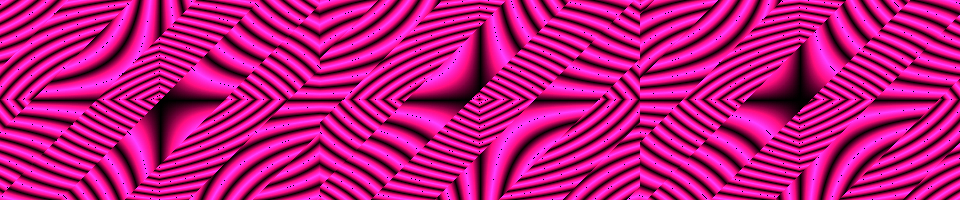
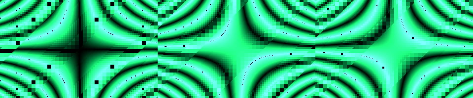

# Continuous atlas show

`ATLAS.COM` presents all 27 atlas effects as one timed DOS program. It includes
flowing title cards, seven wipe shapes, image-derived lead/response voices, a
four-channel rhythm section, bell chimes, palette fades, progress bars and a
final credits screen.

```sh
./run-dosbox.sh atlas-show
```

Space skips the current part or card. Escape ends playback and restores text
mode and the original timer handler. Each effect is scheduled for 16 seconds:
7 minutes 12 seconds of effect time plus titles, transitions and credits. Actual
elapsed time also depends on the CPU and frame completion time.

`./run-dosbox.sh atlas` still runs the standalone demos one by one, with Escape
advancing to the next. `./run-dosbox.sh mega` runs the original thirteen-part
show. Use `--list` to discover the demos and `--help` for launcher syntax.
`DOSBOX_BIN=/path/to/dosbox` can select a particular installed emulator.

## Programme

The sequence groups related ideas and alternates palette families. Each title
states the mechanism to look for; the size shown is the standalone executable,
including its music. The playlist is the single source for both embedding the
part binaries and building their metadata.

| Order | Effect | What to watch |
|---:|---|---|
| 1 | CAUSAL | Waves passing through different chronology shells |
| 2 | TIMELENS | Offsets follow a saddle time field's analytical gradient |
| 3 | HORIZON | Radial differences in animation speed |
| 4 | EMBOSS | Spatial gradients of temporal change produce relief shading |
| 5 | PHASE | Three temporal wave fields interfering |
| 6 | SURGERY | A local clock splits and reconnects a union of implicit discs |
| 7 | COMMUTE | Different orders of coordinate shears |
| 8 | BRACKET | A sequence of shears and their inverses leaves a residual transform |
| 9 | MIRROR | Moving bands choosing involutive coordinate worlds |
| 10 | SIGNED | Signed and unsigned products of the same bytes |
| 11 | RESFIELD | Bands of differently quantized coordinates |
| 12 | TERRACE | Three height fields competing for the maximum |
| 13 | RESIDUAL | Error in a prediction from earlier analytical samples |
| 14 | BIFURC | A quantized logistic parameter sweep |
| 15 | CRITICAL | Nearby initial states are compared after a bounded recurrence |
| 16 | HYSTER | Pixels retaining history inside a threshold band |
| 17 | LOOM | Ordered strand operations on framebuffer state |
| 18 | LIFT | Coupled reversible byte channels |
| 19 | REVERSO | Reversible integer mixing and exact retracing |
| 20 | ORBIT | Exact finite permutation return periods become contour classes |
| 21 | RUNS | A run-length cost field |
| 22 | BYTEVM | An eight-instruction pixel interpreter |
| 23 | SHUFFLE | Interference between permuted virtual lanes |
| 24 | BALLOT | Packed predicates becoming neighbourhood patterns |
| 25 | PREFIX | Inclusive sums of earlier lane displacements |
| 26 | RANK | Exact sorted ranks of eight lane values |
| 27 | RING | Rule-90 evolution on periodic sixteen-cell rings |

## Build and host logic

`build.sh` creates the 40 standalone executables, each at most 256 bytes, then
assembles their shared-service variants. It builds `MEGA.COM` (6,778 bytes)
and `ATLAS.COM` (10,263 bytes) from `src/mega/mega.asm`. The atlas effects total
5,787 standalone bytes; the show host is outside the standalone size budget.

The atlas effects use 386 integer instructions. The continuous show additionally
uses x87 for its title backgrounds and wipe maps, as the original MEGA host does.
VGA is required; audible music needs MPU-401 and a General MIDI synthesizer.
The [music reference](ATLAS_MUSIC.md) documents every voice, channel, rhythm
and its exact relationship to the framebuffer and BIOS clock.

`src/mega/mega_program.inc` defines the thirteen-part show;
`src/mega/atlas_program.inc` defines this twenty-seven-part show. Each playlist
entry contains its title, tagline, duration, standalone size and binary path.
The same list is expanded once for metadata and again for binary embedding.
`ATLAS_SHOW` chooses the atlas programme, title and closing credits at build time.

Each part receives a clean segment, private stack and DOS entry registers. The
host supplies the shared timer limit, key handling and MIDI header through PSP
vectors. A returning part restores the previous timer vector; the host then
transitions to the next card. Stateful effects therefore begin with clean memory.

Credits wrap at name boundaries into a 256-byte buffer. Assembly checks reject
titles wider than 70 characters and playlists larger than that buffer. The atlas
credits fit on the 80x25 text screen and list every part.

## Verification

`tests/test_atlas_show.py` runs the assembled show to completion and checks all
27 timer-hook pairs, all 29 cards, the music programme sequence, every credits
name, multi-row wrapping and DOS exit. Separate runs check Space and Escape.
`tests/test_launcher.py` uses an emulator test double to check selections,
patterns, CLI errors and rebuilding of existing binaries without opening a GUI.
The normal launch path rebuilds before playback, so edits to include files or
playlists cannot silently run stale executables.

The original MEGA regression suite exercises the same host's thirteen-part path.
The [effect notes](DOS_ATLAS_STATE.md), [palette guide](PALETTES.md) and
[coverage ledger](ATLAS_COVERAGE.md) document the effects and remaining proposals.

## A few of the effects

These are captures of the standalone binaries; the show uses the same kernels.





