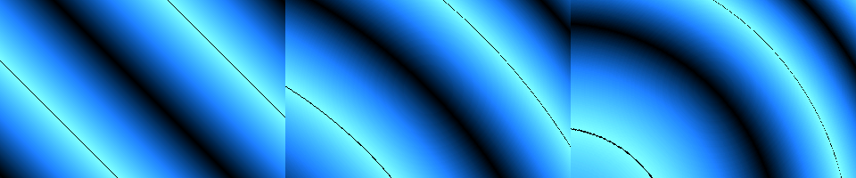
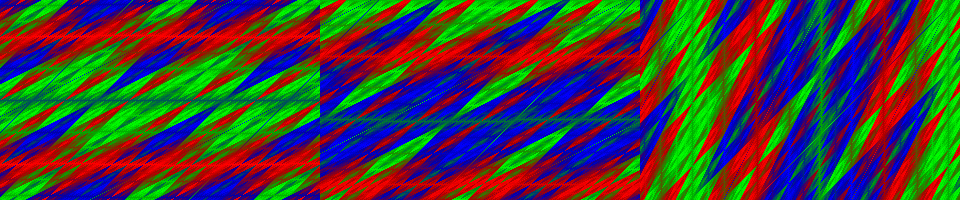
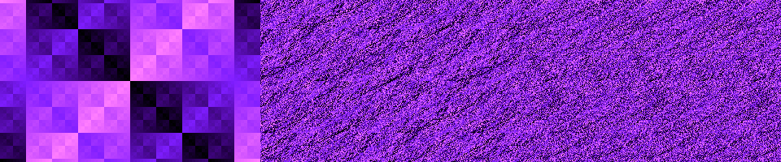
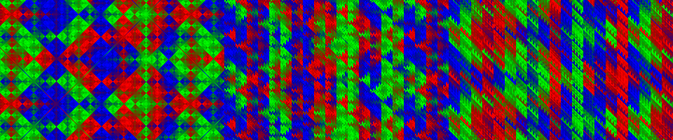

# Additional DOS atlas adaptations

Six new standalone effects use the palette, music, interrupt and exit engine in
`src/temporal.inc`. Each wrapper selects one kernel at assembly time, with no
runtime dispatch or external assets. They are reduced interpretations, not GPU
API implementations. The curated thirteen-part MEGA show is unchanged.
All six also appear in the [continuous atlas show](ATLAS_SHOW.md).

| Demo | Bytes | Proposal | Retained mechanism |
|---|---:|---|---|
| HORIZON | 194 | A04 | Spatially varying animation speed |
| COMMUTE | 229 | B01 | Noncommuting shear order |
| LIFT | 199 | I02 | Exactly reversible byte-channel mixing |
| MIRROR | 198 | I08 | Coordinate involution |
| RESFIELD | 202 | C10 | Resolution as a visible field |
| SHUFFLE | 238 | G02 | Virtual lane permutation |

## Build, run and capture

```sh
./build.sh
./run-dosbox.sh horizon commute lift mirror resfield shuffle
./run-dosbox.sh all
tests/run_tests.sh
.venv/bin/python tools/render_temporal.py
```

Escape exits each standalone effect. `all` includes all forty demos, including
the newer [state and collective batch](DOS_ATLAS_STATE.md).
MPU-401 and a General MIDI synthesizer are required for audible generated music.

## Kernel equations and limitations

Coordinates are x=-160..159, y=-100..99. A frame snapshots
`t=(2*BIOS_tick) mod 65536`. `tri(v)` doubles the absolute value of the signed
low byte and wraps to a byte; its -128 peak deliberately wraps to zero.
`u16(v)` means modulo 65536. Pixels below are VGA palette indices.

### HORIZON

`w=((x*x+y*y)>>8)+1`; `pixel=tri(floor(t*w/256)+x-y)`.
The centre advances more slowly than the edges. Unsigned multiplication retains
the full product in DX:AX, then extracts the byte needed for the triangle wave.
This is quantized radial slowdown, not asymptotic relativity or ray tracing.



### COMMUTE

Shears A(x,y)=(x+y,y) and B(x,y)=(x,y+x) do not commute.
When bit 7 of t is clear, A then B gives `(a,b)=(x+y,x+2*y)`;
otherwise B then A gives `(2*x+y,x+y)`.
`pixel=tri(a+t) XOR tri(b-t)`. The discrete switch compares coordinate frames;
it is not an interactive camera with accumulated movement history.



### LIFT

Start with `(a,b)=(x mod 256,y mod 256)`. Set `q=(t>>3) AND 31`, then
`n=min(q,32-q)`. Apply n steps of `a'=(a+b) mod 256; b'=b XOR a'`.
The inverse is `b=b' XOR a'; a=(a'-b) mod 256`. Display `a XOR b`.
The depth goes 0..16..0: each frame recomputes from the seed, exactly retracing
the coupled byte state without stored history. The displayed XOR is lossy;
only the two-channel state is reversible. This is not a particle simulation.



### MIRROR

Start with unsigned 16-bit x,y. If bit 6 of x+y+t is set, apply
`F(a,b)=(a XOR 255,b XOR 127)`; applying F twice restores both coordinates.
`pixel=tri(u16(a*b)>>3)`. Moving diagonal bands select two coordinate worlds.
The retained property is the involution, not 3D portal geometry.


### RESFIELD

`n=((x+y+t)>>5) AND 3`. Quantize signed coordinates downward to multiples
of 2^n: `a=(x>>n)<<n; b=(y>>n)<<n`, using arithmetic right shifts.
`pixel=tri((u16(a*b)>>4)+t)`. Bands vary between 1/2/4/8-pixel cells.
Every VGA pixel is still evaluated: this is not VRS and promises no speedup
from reducing shader invocations.


### SHUFFLE

Set `p=x+160`, `mask=(t>>2) AND 31`, and
`p'=(p AND ~31)+((p AND 31) XOR mask)`. Each 32-lane group is permuted bijectively.
`pixel=((tri(p'+y) XOR tri(x-y+t))+x) mod 256`.
A carrier gradient prevents low-colour XOR collapse. Transported values are
evaluated procedurally, with no GPU subgroup or cross-thread communication.



## Tests and capture provenance

`tests/test_temporal.py` compares sampled pixels against independent equations
at five clock values including doubled-time wrap boundaries. It checks size,
palette bounds, colour diversity, visible animation, MIDI range and velocity,
interrupt preservation, text-mode exit and BIOS timer restoration. It exhaustively
checks the lifting inverse and mirror involution on byte pairs and all 32 lane
permutations. Captures are actual Unicorn framebuffer/DAC output, not mockups or
DOSBox recordings. These finite tests do not establish real-hardware performance.

All kernels share the image-sampled, two-register music engine described in the
[atlas score reference](ATLAS_MUSIC.md). Frame rate depends on the
machine; repeated lifting is more expensive than the algebraic kernels.
Clock wraps and discrete transform switches can visibly jump.

[Complete 150-proposal coverage ledger](ATLAS_COVERAGE.md).
