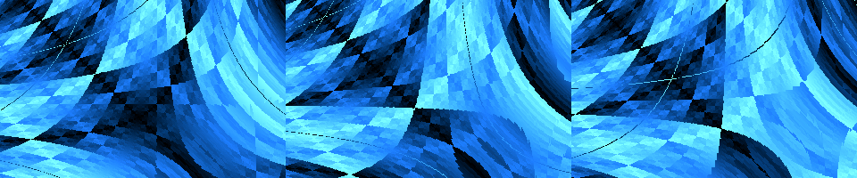
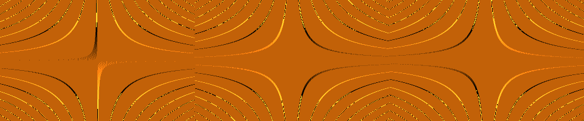
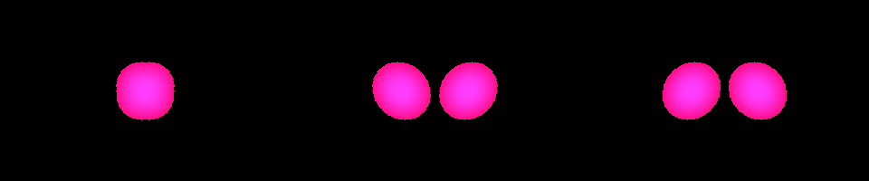
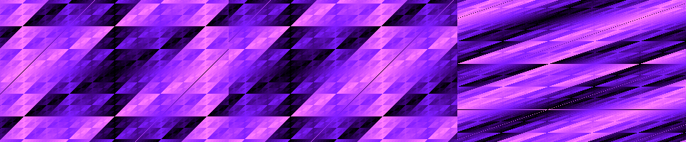
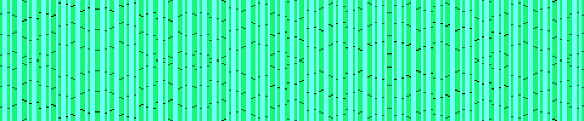
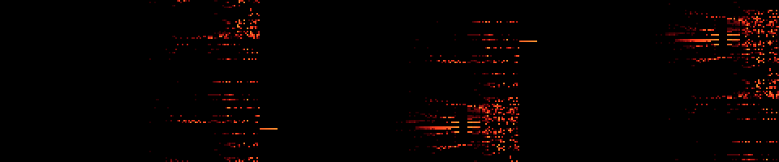

# Temporal fields, topology and finite orbits

Six more DOS adaptations extend the atlas to 27 demos. Each fits within 256
bytes including its generated pentatonic MIDI, palette and timer restoration.
They are integrated into the [continuous show](ATLAS_SHOW.md) with timed cards,
fades and skip controls, and remain individually selectable.

```sh
./build.sh
./run-dosbox.sh timelens emboss surgery bracket orbit critical
./run-dosbox.sh atlas-show
```

## Arithmetic and interpretation

Coordinates are x=-160..159, y=-100..99, and t=(2*BIOS_tick) mod 65536.
Right shifts of signed coordinates round down. u16 is modulo 65536; tri doubles
the absolute value of the signed low byte and wraps to a byte. rol8 is an
8-bit rotation. Outputs select a VGA palette entry. These are explicit integer
adaptations of atlas mechanisms; their retained dimensions and limitations are
specified below.

| Demo | Bytes | Proposal | Palette |
|---|---:|---|---|
| TIMELENS | 210 | A03 | Ice |
| EMBOSS | 231 | A06 | Gold |
| SURGERY | 230 | A10 | Rose |
| BRACKET | 213 | B02 | Orchid |
| ORBIT | 204 | I04 | Emerald |
| CRITICAL | 251 | J09 | Fire |

## TIMELENS — Time-Gradient Lens

Offsets follow a saddle time field's analytical gradient.

`q=u16(x*y)>>7; local=t-q; pixel=tri(x+(y>>3)+local) XOR tri(y+(x>>3)+local-32).`

The displacements scale the gradient of x*y by 1/8. The local clock quantizes the wrapped product by 1/128. Two procedural scene samples use different local ages. This is a two-dimensional analytic lens with integer wrap seams; it has no stored history, transparent geometry or RGB temporal dispersion.



## EMBOSS — Motion-Embossed Matter

Spatial gradients of temporal change produce relief shading.

`f(a)=tri((u16(a*y)>>4)+t); D(a)=f(a)-tri((u16(a*y)>>4)+t-8); pixel=(96+8*(D(x+1)-D(x))) mod 256.`

The kernel samples both current and earlier analytical fields at neighbouring x positions. The eightfold gradient gain makes the relief legible against a mid-level neutral shade. Only one component of the synthetic normal is retained; this is neither a stored depth field nor a full lighting model.



## SURGERY — Temporal Topology Surgery

A local clock splits and reconnects a union of implicit discs.

`d=tri(t-(y>>2))>>2; m=min((x+d)^2+y^2,(x-d)^2+y^2); pixel=255-(m>>3) when m<=1024, otherwise 0.`

Two radius-32 discs move according to spatially varying chronology. Their union changes connected-component count: the binary at tick 0 has one occupied component and the one at tick 37 has two, verified directly on the rendered frames. This retains a genuine two-dimensional topology change, without claiming 3D handles or a ray marcher.



## BRACKET — Lie-Bracket Camera

A sequence of shears and their inverses leaves a residual transform.

`Start (a,b)=(x,y). A: a+=b; B: b+=a; inverse A: a-=b; inverse B: b-=a. Apply the first 1+((t>>4)&3) operations, then display tri(a+t) XOR tri(b).`

The complete word sends (x,y) to (-y,x+3*y), demonstrating noncommutativity. The timeline shows partial products and resets after four stages. It does not accumulate an interactive camera route or approximate an infinitesimal differential-geometric connection.



## ORBIT — Cycle-Length Volume

Exact finite permutation return periods become contour classes.

`mask=((x>>2)+t) mod 256; seed=((y>>1)+128) mod 256; iterate F(v)=rol8(v,1) XOR mask until seed returns; pixel=15*period.`

Every map returns in at most 16 iterations, because F^8 is either identity or complement, and F^16 is identity. Periods divide 16. Four-by-two-pixel cells make the five possible period classes readable. This is a two-dimensional period field instead of a 3D volume; no bounded nonreturn is falsely labelled as an exact period.



## CRITICAL — Criticality Fog

Nearby initial states are compared after a bounded recurrence.

`r=(x+160)//2+96; a=(y+t+128) mod 256; b=a XOR 1. Repeat a=floor(a*(256-a)/256)*r//64 and the same for b sixteen times. Let d=abs(a-b); pixel=2*d for 8<=d<96, otherwise 0.`

Frozen pairs and widely separated pairs stay dark; intermediate divergence is visible. The effective recurrence parameter is r/64. Byte quantization changes the dynamics, so the result is a short-term divergence mask, not proof of chaos or a volumetric fog renderer.



## Implementation and validation

The wrappers select new kernels in `src/temporal.inc`. SURGERY reuses y*y once
per scanline. Every loop has a fixed bound: ORBIT at most sixteen transformations
and CRITICAL sixteen paired recurrence updates. All pixels stay inside the
320x200 framebuffer; no neighbouring memory is sampled for these analytic fields.
The shared timer probe, effect-specific instruments, octave response and exit
path are described in the [atlas score reference](ATLAS_MUSIC.md).

`tests/atlas_state_reference.py` independently specifies each pixel equation.
The framebuffer tests compare every pixel at five BIOS ticks, including the two
sides of clock wrap, and check animation, palettes, MIDI and timer restoration.
A four-neighbour flood fill verifies SURGERY's component-count change. The ORBIT
return bound is checked for all 65,536 seed/mask pairs. The continuous-show test
and palette tests derive their effect inventories from the updated lists.

Capture the actual assembled binaries with:

```sh
.venv/bin/python tools/render_temporal.py timelens emboss surgery bracket orbit critical
```

The PNGs above are framebuffer/DAC captures, not reference-model renders. CRITICAL
is deliberately sparse, and ORBIT has only five mathematical contour classes.
EMBOSS amplifies quantized derivatives, including their wrap boundaries. Frame
rates depend on the machine; these are not physical-hardware timing results.

[Full 150-proposal coverage](ATLAS_COVERAGE.md): 28 adapted IDs across 27 demos;
122 proposals remain unimplemented.
