# State, interpretation and software collectives

Thirteen further DOS adaptations extend the atlas collection. Each binary includes
its generated MIDI music, palette and clean timer exit within 256 bytes. All are
available standalone and in the [continuous atlas show](ATLAS_SHOW.md).
The curated thirteen-part MEGA show remains unchanged.

## Run and verify

```sh
./build.sh
./run-dosbox.sh atlas-show
./run-dosbox.sh atlas
./run-dosbox.sh hyster residual signed runs bytevm reverso bifurc terrace loom ring prefix rank ballot
tests/run_tests.sh
.venv/bin/python tools/render_temporal.py hyster loom ballot
```

The launcher `all` includes all 40 standalone demos. Escape exits each demo.
MIDI needs MPU-401 plus a General MIDI synth. New demos are not automatically
inserted into MEGA; this avoids silently changing its duration and choreography.

## Conventions and shared engine

Coordinates x=-160..159 and y=-100..99 are signed. t is twice the BIOS tick,
wrapped to 16 bits and sampled once per frame. `u16` and `low8` are modulo
65536 and 256; `s8` interprets a byte as signed. `tri(v)` is twice the absolute
value of s8(v), wrapped to a byte. `high8` selects bits 8..15 of a 16-bit product.
Rotations preserve the stated bit width. Arithmetic wrap and discrete transitions
are intentional. Outputs are VGA palette indices, not linear RGB values.

Each `src/<name>.asm` wrapper selects a compile-time kernel in `temporal.inc`.
The shared engine initializes mode 13h and an effect-specific vivid palette, snapshots
time, traverses exactly 320x200 pixels, waits for retrace, polls Escape and restores
the old timer hook/text mode. `triangle` is a byte wave helper. `isr` preserves
registers and sends a pentatonic lead plus a two-octave response sampled from
video memory. Every wrapper selects a different voice; see [ATLAS_MUSIC.md](ATLAS_MUSIC.md).
Stateful kernels store only in their own framebuffer pixel; they do not read an
unwritten neighbour or depend on a cross-pixel race.

The [palette guide](PALETTES.md) lists the seven colour families. Spectrum effects
rewrite the 256-entry VGA DAC once per frame with a slow clock-based phase.
The framebuffer history in HYSTER and LOOM retains a fixed palette.

## Effects

| Binary | Bytes | Proposal | Retained mechanism |
|---|---:|---|---|
| HYSTER | 195 | J06 | Real per-pixel history |
| RESIDUAL | 206 | J04 | Analytical prediction error |
| SIGNED | 189 | N02 | Signed/unsigned byte interpretation |
| RUNS | 227 | J08 | Run-length description cost |
| BYTEVM | 243 | H01 | Bounded eight-opcode interpreter |
| REVERSO | 208 | I01 | Exact 16-bit bijection |
| BIFURC | 226 | J01 | Bounded logistic recurrence |
| TERRACE | 206 | F07 | Serialized extrema reduction |
| LOOM | 192 | F01 | Ordered, noncommuting feedback |
| RING | 221 | G09 | Periodic cellular neighbours |
| PREFIX | 202 | G03 | Inclusive software prefix sum |
| RANK | 238 | G04 | Exact lane-value ranks |
| BALLOT | 207 | G01 | Packed predicate neighbourhood |

### HYSTER — Hysteretic Boundary Matter

`v=tri(x+y+t); state=255 if v>=160, 0 if v<=96, otherwise previous pixel.`

The 96..160 dead band retains the previous framebuffer value. This is a binary history-dependent material, not 3D geometry. Initial mode 13h clears the framebuffer; repeated calls at a fixed time preserve the dead-band state.


### RESIDUAL — Predictor-Residual Weather

`v=(u16(x*y)>>4)+t; pixel=(tri(v)-2*tri(v-8)+tri(v-16)) mod 256.`

Two earlier analytic samples predict the current sample by linear extrapolation. Only their residual is shown. There are no stored weather fields, neighbourhood diffusion or cloud feedback.

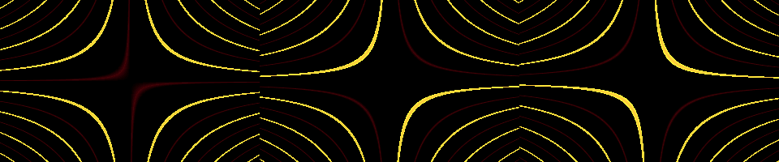

### SIGNED — Signedness Doppelgänger

`a=(x+t) mod 256; b=(y+128) mod 256; pixel=high8(a*b) XOR high8(s8(a)*s8(b)).`

Both products use the exact same operand bits. The signed product is represented in two's complement. No GPU texture views, format queries or shared texture storage are claimed.

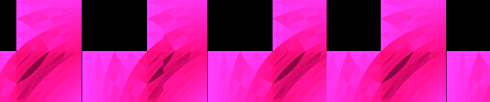

### RUNS — Compressibility Terrain

`w=u16((u16(321*x) XOR u16(y))+t); r=1+sum(bit(w,i) XOR bit(w,i+1), i=0..14); pixel=(16*r) mod 256.`

The number of runs estimates the cost of a run-length encoding. Sixteen runs wrap deliberately to palette index zero. This is a flat cost field, not an actual compressor, entropy metric or 3D terrain.

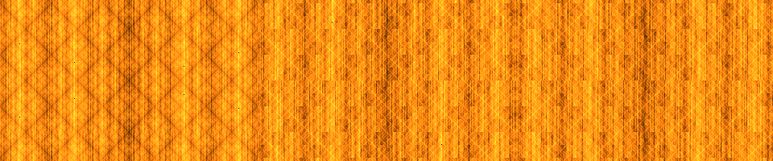

### BYTEVM — Pixel Virtual Machine

`a=u16(x); execute the eight low-to-high 2-bit opcodes in 0xB39C; output low8(a XOR (a>>8)).`

Opcodes are 0:add y, 1:xor t, 2:rotate left by three, 3:negate. Every operation is modulo 65536. The same fixed tape runs for every pixel. The tape is data for this interpreter, never arbitrary x86 execution. No tape search or external bytecode loader is implemented.

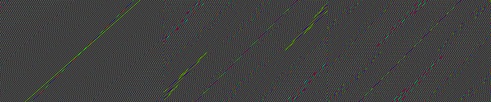

### REVERSO — Reversible Integer Universe

`a=u16(257*x XOR y); q=(t>>3)&15; iterate F min(q,16-q) times; F(a)=rol16(u16(a+1973),5) XOR 0xA53C; pixel=low8(a XOR (a>>8)).`

The inverse is u16(ror16(a XOR 0xA53C,5)-1973), tested for every 16-bit input. Depth follows 0..8..0, recomputed from the seed, so it retraces exactly without a stored simulation. The folded displayed byte is not itself reversible.

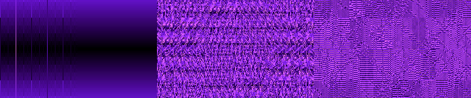

### BIFURC — Bifurcation Foam

`r=((x+160+((t>>3)&255)) mod 320)//2+96; a=y+128; repeat a=(floor(a*(256-a)/256)*r)//64 sixteen times; pixel=(a16-a15) mod 256.`

The effective parameter r/64 sweeps 1.5..3.984375. The displayed residual detects approach to a period-one fixed point; it does not prove chaos or classify all periods. Fixed-point rounding introduces quantization and the parameter sweep wraps.

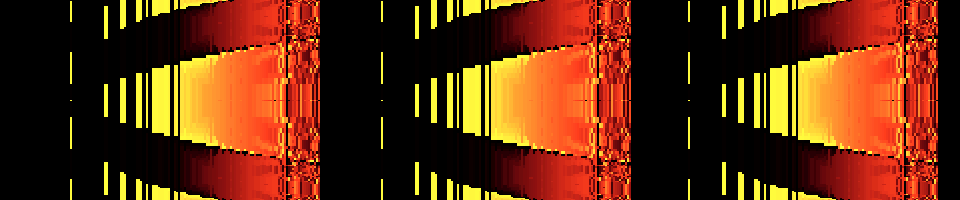

### TERRACE — Atomic Min/Max Terraces

`pixel=max(tri(x+t),tri(y-t),tri(x+y)) AND 240.`

Three candidate height fields compete and the winning maximum is quantized to sixteen terraces. CPU serialization replaces any atomic operation. No thousands-of-surfaces claim or GPU contention is implied.

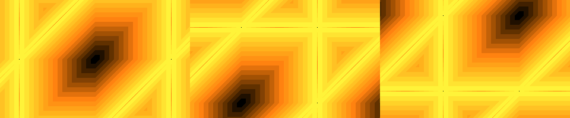

### LOOM — Programmable Blend Loom

`a=previous pixel; if bit4(x+t): a=(a+17) mod 256; if bit4(y-t): a=rol8(a,1); pixel=a.`

The two moving strand masks perform add then rotate on persistent framebuffer state. Reversing these operations generally changes the result. Updates are naturally serialized by the CPU; there is no fragment interlock. Unlike the clock-evaluated effects, the image depends on rendered frame count.

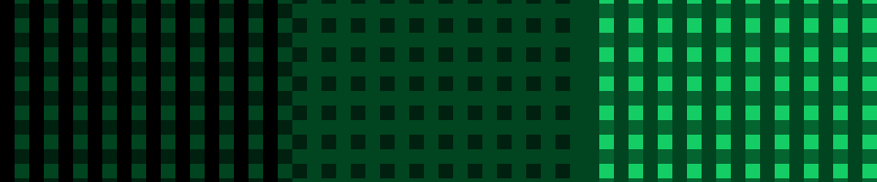

### RING — Cross-Lane Cellular Ring

`a=u16(1973*(x>>4)) XOR 0x35A7; repeat a=rol16(a,1) XOR ror16(a,1) (((t>>3)+y)&15) times; pixel=255 if bit(a,x&15) else 0.`

A 16-cell rule-90 ring uses genuinely periodic boundaries. Generation depth is bounded and recomputed per pixel. On a 16-cell ring this rule reaches zero by generation eight; the dark bands are the defined finite-ring result, not failed rendering. There are no physical shader lanes.

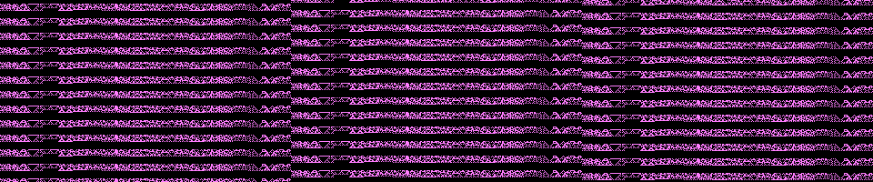

### PREFIX — Prefix-Scan Ribbons

`pixel=(y+sum((tri(y+t+13*k)>>4)-8, k=0..(x&15))) mod 256.`

Each lane contains its own and all preceding lane displacements. The CPU recomputes a bounded 1..16-term scan per pixel. No GPU scan instruction or ribbon geometry buffer is used.

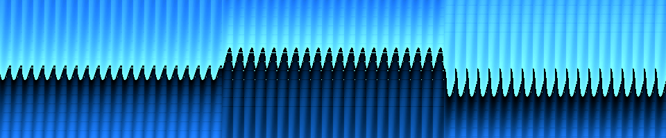

### RANK — Wave Sort Prism

`v[k]=low8(37*k XOR (y+t)), k=0..7; pixel=32*rank(v[x&7]).`

The eight values are distinct. The kernel counts strictly smaller values, yielding the same rank as sorting; tests independently sort the array. It does not execute a GPU sorting network or move geometry.

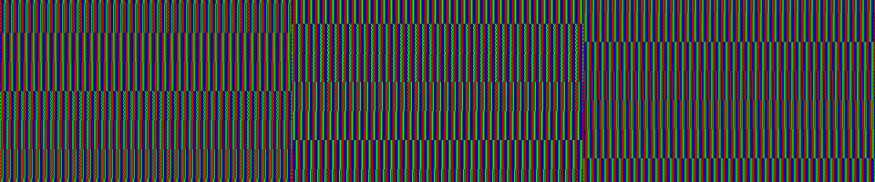

### BALLOT — Ballot Topology

`vote[k]=(tri((x&~15)+y+t+13*k)>=128), k=0..15; pack lane0 in bit15; pixel=low8(rol16(mask,x&15)).`

Sixteen explicit predicates form a mask; rotating it exposes different neighbourhoods. This is a software ballot with logical lanes and no GPU invocation-layout dependency.

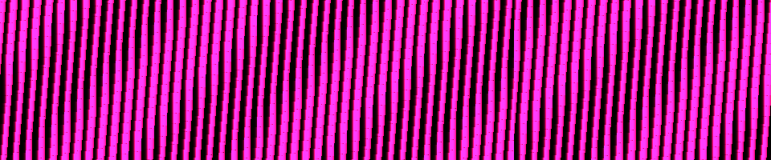

## Validation and capture provenance

`tests/atlas_state_reference.py` specifies the equations independently in Python.
`tests/test_atlas_state.py` compares every pixel of five complete frames per demo,
including clock-wrap boundaries; it checks visible change, palette limits, size,
interrupt registers, MIDI pitch/velocity and DOS exit. HYSTER and LOOM also have
multi-frame history tests across a ten-step clock sequence. REVERSO's inverse is
verified exhaustively for all 65,536 states. Rank uses an independent Python sort;
the ring reference explicitly indexes periodic neighbour cells.

Captures come from the actual assembled binary and emulated VGA DAC, not from
the Python reference. Stateless sheets show fresh starts at ticks 0,37,91.
HYSTER and LOOM sheets preserve state through exactly three successive rendered
frames at ticks 0,8,16; this sparse sequence is not a real-time recording.
The capture tool checks that each frame finished within its instruction budget.

Tests are not hardware benchmarks. Iterative kernels can be slow on old CPUs.
The byte VM has exactly eight operations; the recurrence and collectives have
fixed iteration limits. Binary patterns and palette changes may flicker; users
sensitive to flashing patterns should avoid these effects. No perceptual, GPU
performance, world-first or real-hardware compatibility claim is made.

[All 150 proposals and remaining work](ATLAS_COVERAGE.md).
