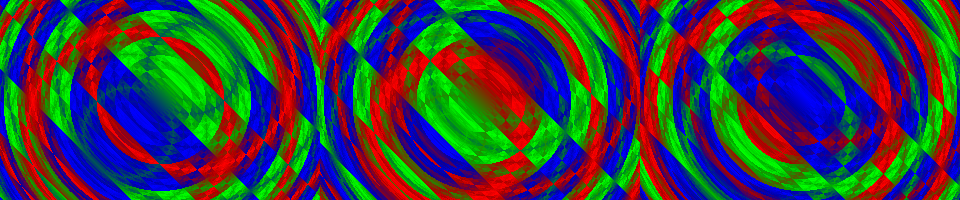
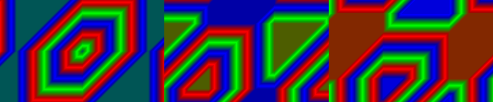
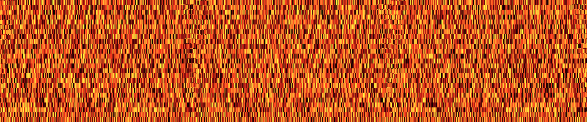
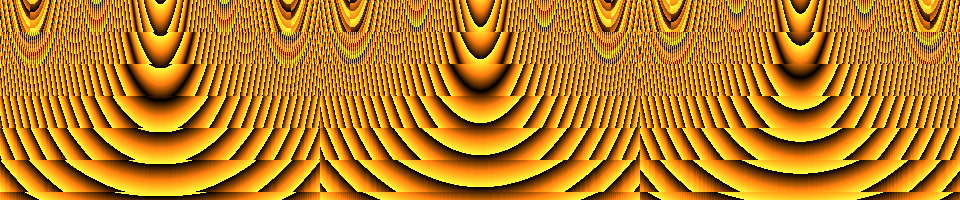
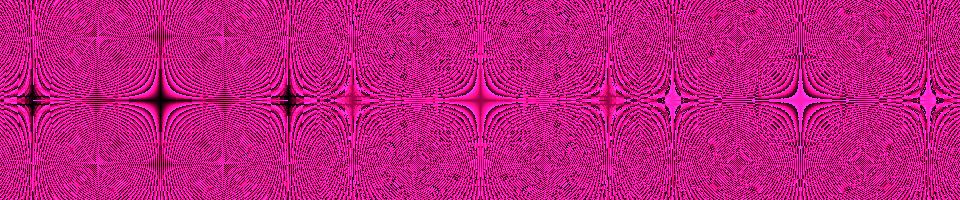

# Six new 256-byte effects

This batch implements the six concrete DOS-effect proposals in the supplied
`256.md` as native 16-bit `.COM` programs. The document was treated as a design
brief, not as proof that similarly named code already existed. Each implementation
uses the repository's real Mode 13h engine, generated VGA palette, timer ISR,
General MIDI output and cleanup path.

## Shipped programs

| Program | Bytes | Integer kernel | Palette | MIDI program |
|---|---:|---|---|---:|
| `XORTUN.COM` | 214 | `(x²+y²)>>6 XOR (x-y+2t)` | cycling spectrum | 80, square lead |
| `PLASMA.COM` | 226 | three signed-byte triangle waves | cycling spectrum | 89, warm pad |
| `CAFLAME.COM` | 211 | prior-frame cellular feedback from eight rows below | fire | 98, crystal |
| `VOXFLOOR.COM` | 195 | depth-shifted `x²` plus scanline shade | gold | 38, synth bass |
| `KALEIDO.COM` | 207 | folded coordinates, radius and cross term | rose | 94, halo pad |
| `RAYMARCH.COM` | 223 | bounded eight-slice circle-distance search | emerald | 99, atmosphere |

All sizes are release binaries assembled by `./build.sh`; the build fails if any
standalone exceeds 256 bytes.

## Shared execution contract

The wrappers in `src/*.asm` contain the public ID, title, summary, selected kernel,
palette and MIDI instrument. `src/novel_effect.inc` rejects missing metadata,
invalid palette/program numbers or multiple kernels at assembly time, then includes
`src/temporal.inc`.

The shared engine enters VGA 320×200×256 mode, installs an INT 1Ch handler, snapshots
the BIOS tick once per frame, draws exactly 64,000 pixels and checks Escape between
frames. The ISR chains to the previous handler and emits a bounded pentatonic
note-on/note-off pair. Exit restores the original vector, sends MIDI all-notes-off,
returns to text mode 3 and exits to DOS.

Kernel inputs are `BX=x` (-160…159), `SI=y` (-100…99), `BP=2×BIOS tick`, and
`DI=framebuffer offset`; each kernel returns one palette index in `AL`. Arithmetic
wrap is intentional 16-bit x86 behavior.

## Effect logic

### XOR Tunnel Spiral

Squared distance produces concentric bands without a square root. XOR with a moving
diagonal phase breaks the rings into a rotating tunnel-like field. The spectrum
palette itself advances independently, so geometry and colour never lock to the
same short cycle.

### Palette Plasma Flow

The triangle helper folds the low signed byte around zero. Three waves move on the
x axis, y axis and x+y diagonal at different phase rates; byte overflow mixes them
without division or lookup tables.

### Cellular Flame

This is the stateful member of the batch. Each pixel combines three bytes from the
previous frame eight rows below, then rotates and adds the centre value to preserve
heat. The bottom eight rows are deterministic moving fuel. The eight-row stride
fills the screen quickly while retaining genuine framebuffer feedback.

### Voxel-Floor Shade

The scanline chooses a right shift from 0 through 6. Applying that shift to `x²`
compresses distant bands and expands near ones; scanline and time terms provide
depth shading and forward motion. This is a procedural perspective floor, not a
voxel ray caster or height-map renderer.

### Kaleido Mode

Branchless signed absolute values fold the plane into four quadrants. A radial
square-distance term is XORed with twice the `abs(x)×abs(y)` cross term, creating
mirror symmetry and fine interference that rotates through the palette.

### Mini Raymarch Tunnel

Every pixel tests at most eight depth slices. A triangle-wave offset moves the circle
centre at each slice; the first squared-distance hit is shaded by remaining steps
and depth. It is deliberately a bounded integer distance search—not a general 3D
signed-distance renderer—so frame time and code size stay controlled.

## Verification and reproducibility

`tests/novel_reference.py` is an independent Python specification of every integer
operation, including word/byte wrap and cellular history. `tests/test_novel_effects.py`
runs the assembled binaries under Unicorn and compares all 64,000 output bytes at
five tick values, including the signed-word boundary and BIOS-tick wrap. It also
checks palette bounds, mapped-memory safety, animation, ISR chaining, MIDI program
and notes, Escape cleanup and text-mode restoration.

`tools/render_novel_reference.py` renders the six maintained contact sheets from
the same explicit reference contract. `--check` compares generated pixels with the
tracked images, giving CI a deterministic visual-regression gate. The browser build
additionally embeds each exact COM, thumbnail and fully expanded assembly source.

Unicorn proves the instruction-level contract and the hosted player runs a separate
DOSBox-X WebAssembly engine. Timing and appearance on original VGA hardware can
still vary with CPU speed, DAC behavior and MIDI device; no real-hardware result is
claimed without a real-hardware capture.
