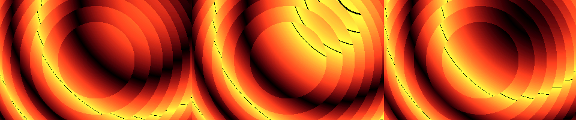
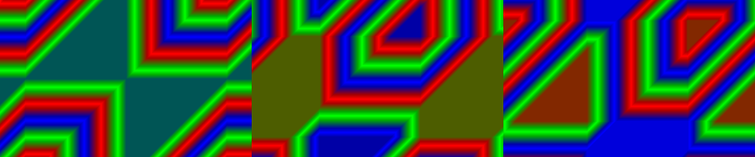

# Temporal atlas experiments

Two standalone demos adapt ideas from the supplied *Beyond the Familiar Shader*
research atlas. They use the lab's DOS/386/VGA/MPU-401 architecture. Neither needs
an FPU, shaders, a history buffer, or external assets. Each is below 256 bytes,
including generated music and restoration of the timer vector on exit.

## CAUSAL — 200 bytes

Adapted from A02 (Causal Cone Refraction) and A05 (Chronology Cutaway).
Concentric regions evaluate a traveling wave at different local times. The
extra delay at shell boundaries breaks the wave into staggered temporal layers.

For centered screen coordinates x in [-160,159], y in [-100,99]:

```text
t = (2 * BIOS_tick) mod 65536
r = floor((x*x + y*y) / 256)
local_time = t - r - (r AND 0xfff0)
pixel = triangle(x - y + local_time)
```

The continuous term r delays the wave with distance; the quantized term adds an
extra delay every 16 units of r. The distance is squared, so this is an artistic
delay field, not a constant-speed physical light cone or an optical refraction
simulation. The result is deterministic and can evaluate past states directly.



## PHASE — 228 bytes

Adapted from A08 (Chronophase Interference). Three periodic fields combine with
opposing temporal directions and one half-speed phase:

```text
pixel = (triangle(x+t) + triangle(y-t) - triangle(x+y+(t >> 1))) mod 256
```

Triangle waves replace trigonometric/complex phase accumulation to fit DOS
sizecoding. Summation and subtraction produce moving interference bands; byte
overflow is an explicit part of the image, not an out-of-bounds memory access.
This is a phase-field adaptation, not a claim of full complex wave simulation.



## Shared implementation

`src/temporal.inc` emits the complete executable for each small wrapper. The
triangle function interprets its input's low byte as signed, takes its absolute
value, doubles it, then wraps to eight bits. Its -128 peak intentionally wraps
to zero. CAUSAL uses the vivid Fire palette; PHASE uses a smoothly cycling
Spectrum palette. Channels stay in the DAC's 0..63 range. See the
[palette guide](PALETTES.md).

CAUSAL and HORIZON compute y*y once per scanline, reducing that multiply
from 64,000 to 200 evaluations per frame while retaining the same pixel values.

The BIOS clock is sampled once per frame to avoid temporal tearing within the
pixel loop. Rendering waits for vertical retrace before checking Escape. Time
wraps modulo 16 bits; PHASE's half-speed component has a deliberate phase reset
at that wrap, rather than an unbounded accumulator. No frame-rate promise is made.

An INT 1Ch handler runs independently of rendering. It samples video memory at
a moving probe, maps the sampled value into C-major pentatonic notes, and sends
both a lead and a response two octaves below. CAUSAL uses music box; PHASE uses
glockenspiel. The handler preserves general registers and
uses an explicitly zeroed FS for the BIOS clock. MPU-401 and a GM synthesizer
are needed for audible playback; the visual effects work without a synth.
The full 27-effect orchestration is documented in [ATLAS_MUSIC.md](ATLAS_MUSIC.md).

## Build and run

```sh
./build.sh
./run-dosbox.sh causal phase
tests/run_tests.sh
.venv/bin/python tools/render_temporal.py
```

Both are selectable by name and included in the launcher's `all` sequence.
They also play after ROOTS in the thirteen-part MEGA show, each for 16 seconds
plus its title and transitions. Both use the shared title cards, palette fade-in,
sepia drain, progress display, Space skip and Escape exit. Run the full show with
`./run-dosbox.sh mega`.

The new tests check representative pixel values against independent formulas at
five clock values (including wrap boundaries), visible animation, palette bounds,
memory boundaries tracked by the harness, size, MIDI pitch/velocity, interrupt
register preservation and clean exit. Images above are captures of actual
Unicorn-emulated binaries and DAC output, not DOSBox or physical VGA captures.
They do not establish real-hardware timing or subjective music quality.

## Selection rationale and limits

The atlas proposes modern GPU mechanisms, but this repository intentionally
targets DOS. Temporal evaluation is a useful fit because deterministic equations
can represent multiple ages without storing full history frames. Sparse textures,
fragment interlocks, subgroup operations and Metal tile memory cannot honestly
be implemented as those API mechanisms in these DOS programs. No such support,
world-first novelty, or GPU performance measurements are claimed here.
